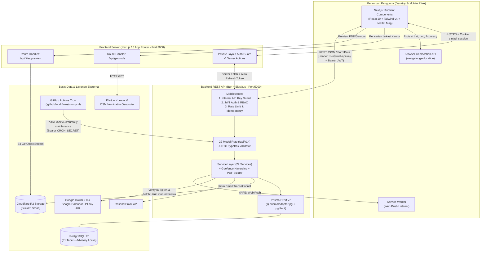
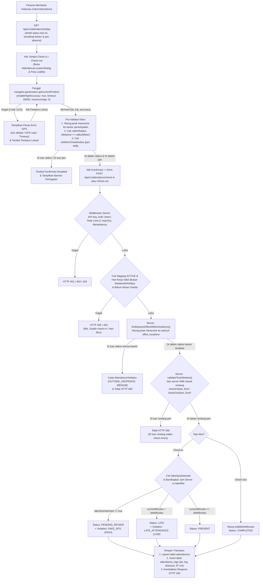
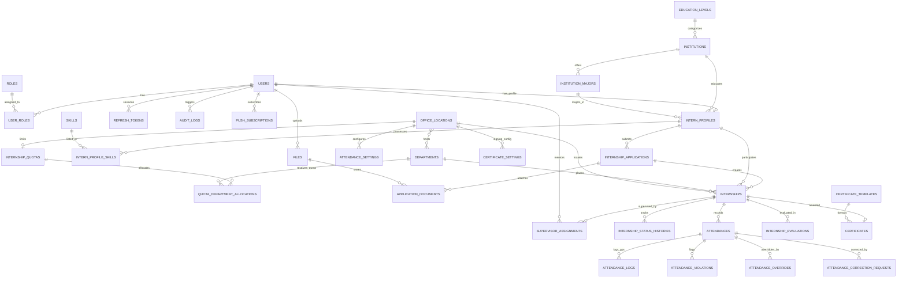
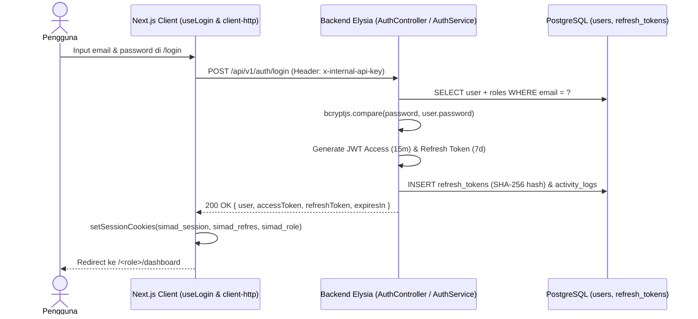
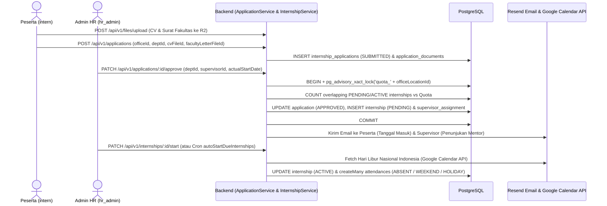
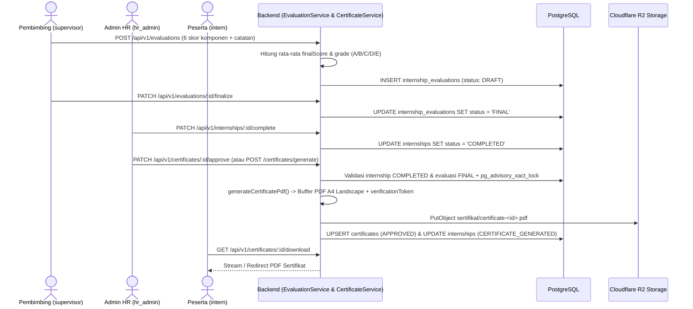

# Ringkasan Teknis Proyek SIMAD (Sistem Informasi Manajemen Magang & Absensi Digital)

> Dokumen ini disusun secara otomatis dari hasil pembacaan *read-only* terhadap kode sumber, konfigurasi, *dependency manifest*, skema dan migrasi basis data, dokumentasi internal, serta riwayat Git pada repositori `SIMAD`. Seluruh temuan mencantumkan *path* file sumber dan mematuhi aturan ketat tanpa menyertakan *secret* apa pun.

---

## 1. Identitas Proyek

- **Nama Proyek**: **SIMAD** — *Sistem Informasi Manajemen Magang & Absensi Digital* (pada konfigurasi aplikasi `fe/src/configs/app.config.ts`, `README.md`, dan templat sertifikat `be/src/utils/pdf.util.ts` merujuk pada **PT PLN (Persero)**, khususnya referensi Unit Induk Distribusi pada sertifikat dan data *seed* wilayah Aceh/Banda Aceh di `be/prisma/seed.ts`).
- **Deskripsi Singkat**:
  SIMAD adalah platform berbasis web *full-stack* yang mendigitalisasi siklus administrasi program magang dari hulu ke hilir di lingkungan PT PLN (Persero). Sistem ini mencakup pendaftaran peserta magang secara daring beserta pengunggahan berkas wajib (CV dan Surat Permohonan Fakultas), pengelolaan kuota dinamis per kantor dan departemen dengan *database concurrency lock*, peninjauan dan penjadwalan tanggal mulai magang oleh HR Admin, pelaksanaan orientasi (*onboarding*), pencatatan kehadiran harian (*check-in* dan *check-out*) berbasis validasi geolokasi (*geofencing* radius kantor dengan rumus Haversine) dan integrasi kalender hari libur nasional, permohonan koreksi serta *override* absensi oleh pembimbing (*supervisor*), evaluasi kinerja akhir peserta pada 6 aspek penilaian, hingga persetujuan dan penerbitan sertifikat magang digital berformat PDF yang dilengkapi token serta *QR Code* verifikasi publik.
- **Struktur Repositori**: **Monorepo** (`git@github.com:MuliaAndiki/SIMAD-Persero.git`) yang memisahkan aplikasi *Backend REST API* (`be/`) dan *Frontend Web Application* (`fe/`) dalam satu repositori bersama dokumentasi spesifikasi (`docs/`), konfigurasi kontainer (`docker-compose.yml`), dan otomasi *cron* (`.github/workflows/cron.yml`).
- **Ringkasan Struktur Folder Utama**:

| Path Direktori / File | Deskripsi dan Fungsi Faktual di Kode |
| :--- | :--- |
| `be/` | Aplikasi *Backend REST API* berbasis **Bun** + **Elysia.js** + **Prisma ORM v7**. |
| `be/prisma/` | Skema basis data (`schema.prisma`), konfigurasi adapter `pg` (`client/index.ts`), *seed* data master (`seed.ts`), dan riwayat migrasi SQL (`migrations/`). |
| `be/src/config/` | Konfigurasi aplikasi, validasi variabel *environment* berbasis Zod (`env.config.ts`), koneksi basis data (`databases.ts`), serta tata letak PDF sertifikat (`certificate.template.config.ts`). |
| `be/src/routes/` | Definisi 22 modul rute API yang diregistrasikan melalui `be/src/routes/apiRoutes.ts` di bawah *prefix* `/api/v1` serta rute `/health` di `be/src/routes/healthRoutes.ts`. |
| `be/src/controllers/` | *Controller layer* yang menangani *request/response* HTTP untuk masing-masing modul domain. |
| `be/src/services/` | *Service layer* berisi logika bisnis utama (22 file *service*: absensi, autentikasi, pengajuan, magang, kuota, koreksi, evaluasi, sertifikat, laporan, notifikasi, *web push*, email, *cleanup*, kalender, dll.). |
| `be/src/middlewares/` | *Middleware* autentikasi JWT & RBAC (`auth.ts`), validasi *Internal API Key* (`api-key.ts`), *rate limiting* (`rateLimit.ts`), dan *idempotency* (`idempotency.ts`). |
| `be/src/dtos/` & `be/src/types/` | Skema validasi *payload* berbasis Elysia/TypeBox (`dtos/`) dan definisi tipe/enum TypeScript (`types/`). |
| `be/src/utils/` | Utilitas perhitungan Haversine (`geofence.util.ts`), pembuat PDF sertifikat tanpa *library* eksternal (`pdf.util.ts`), klien S3 Cloudflare R2 (`r2-utils.ts`), autentikasi (`auth.util.ts`), dan *logger* Pino (`logger.ts`). |
| `be/src/tests/` | Suite pengujian unit dan integrasi menggunakan `bun:test` (5 file pengujian). |
| `fe/` | Aplikasi *Frontend Web* berbasis **Next.js 16 (App Router)** + **React 19** + **Tailwind CSS v4**. |
| `fe/src/app/(public)/` | Halaman publik tanpa login (Landing Page `/home`). |
| `fe/src/app/(auth)/` | Halaman autentikasi (`/login`, `/register`, `/forgot-password`, `/reset-password`, `/verify-email`, `/magic-link`). |
| `fe/src/app/(private)/` | Halaman terproteksi sesi login yang dipisah per peran: `/intern/*`, `/hr_admin/*`, `/supervisor/*`, `/receptionist/*`, serta *dispatcher* `/dashboard`. |
| `fe/src/app/api/` | Next.js *Route Handlers* internal untuk *proxy* pencarian lokasi/geocoding (`/api/geocode`), *streaming preview* dokumen dari R2 (`/api/files/preview`), manajemen sesi cookie (`/api/session/delete`), dan *proxy gateway* (`/api/proxy/[...slug]`). |
| `fe/src/api/` & `fe/src/services/` | Lapisan HTTP *client* (`client-http.ts`) dan *server fetch* (`server-fetch.ts`) beserta *service wrapper* per modul API dan *service* R2 di sisi klien (`r2.service.ts`). |
| `fe/src/components/` | Hirarki komponen antarmuka Atomic Design (`atoms/`, `molecules/`, `organisms/`, `page/`, `template/`, `pwa/`, `svg/`). |
| `fe/src/hooks/` & `fe/src/stores/` | *Custom React Hooks* (termasuk TanStack Query *wrapper* `useApi`, `useInternAccess`) dan manajemen *state* global Redux Toolkit (`stores/`). |
| `fe/src/utils/` | Utilitas *frontend*: perhitungan Haversine & *time window* (`geofence.ts`), akuisisi GPS (`geolocation.ts`), pemetaan status absensi (`attendance-status.ts`), kompresi gambar (`image-compression.ts`), dan manajemen cookie sesi (`session-cookie.ts`). |
| `docs/` | Dokumentasi analisis sistem, PRD, ERD SQL (`03. erd.sql`), aturan bisnis (`04-business-rules.md`), arsitektur (`06-system-architecture.md`), dan spesifikasi API (`07-api-specification.md`). |
| `.github/workflows/cron.yml` | Konfigurasi GitHub Actions terjadwal untuk memicu *endpoint cron* `/api/v1/cron/daily-maintenance`. |
| `docker-compose.yml` | Definisi layanan kontainer PostgreSQL 17 untuk basis data lokal. |

> **Catatan Fakta Terkait `README.md`**: File `README.md` di *root* menyebut adanya folder `observability/` (Grafana, Loki, Tempo, Alloy) di dalam `docker-compose.yml`. Namun secara faktual di repositori, folder `observability/` **TIDAK DITEMUKAN DI KODE** dan `docker-compose.yml` hanya berisi satu *service* yaitu `db` (`postgres:17`).

---

## 2. Teknologi

Seluruh daftar teknologi dan versi di bawah ini diambil langsung dari manifest `be/package.json`, `fe/package.json`, `be/Dockerfile`, dan `docker-compose.yml`.

| Komponen | Teknologi / Library | Versi (dari Manifest) | Fungsi Faktual di Proyek | Sumber File |
| :--- | :--- | :--- | :--- | :--- |
| **Runtime Backend** | Bun (`oven/bun`) | `1.3` (Dockerfile) / `1.4.4` (CLI) | Runtime JavaScript/TypeScript, *package manager*, dan *test runner* (`bun:test`). | `be/Dockerfile`, `be/package.json` |
| **Framework Backend** | Elysia.js (`elysia`) | `^1.4.28` | HTTP REST API framework utama dengan validasi skema TypeBox bawaan (`t`). | `be/package.json`, `be/src/app.ts` |
| **Database** | PostgreSQL | `17` (`postgres:17`) | Basis data relasional utama penyimpan 31 tabel sistem. | `docker-compose.yml`, `be/prisma/schema.prisma` |
| **ORM & DB Adapter** | Prisma ORM (`prisma`, `@prisma/client`, `@prisma/adapter-pg`, `pg`) | `7.10.0` (Prisma) / `^8.23.1` (`pg`) | Pemetaan objek-relasional dengan *driver adapter* `PrismaPg` dan *connection pool* (`max: 20`), mendukung *interactive transaction* dan *PostgreSQL advisory lock* (`pg_advisory_xact_lock`). | `be/package.json`, `be/prisma/client/index.ts` |
| **Autentikasi & Keamanan Backend** | `jsonwebtoken` | `^9.0.2` | Pembuatan dan verifikasi JWT Access Token (HS256, 15 menit) dan Refresh Token (7 hari). | `be/package.json`, `be/src/services/auth.service.ts` |
| **Hashing Password** | `bcryptjs` | `^3.0.2` | Hashing kata sandi pengguna (`saltRounds = 10`) dan komparasi saat login/ganti password. | `be/package.json`, `be/src/services/auth.service.ts` |
| **OAuth 2.0** | `google-auth-library` (BE) / `@react-oauth/google` (FE) | `^10.5.0` (BE) / `^0.13.5` (FE) | Autentikasi *Single Sign-On* (SSO) menggunakan akun Google (`verifyIdToken` & Google UserInfo API). | `be/package.json`, `fe/package.json`, `be/src/services/auth.service.ts` |
| **Security Headers & CORS** | `elysia-helmet`, `@elysiajs/cors`, `@elysiajs/swagger` | `^3.1.0`, `^1.4.0`, `^1.3.1` | Proteksi HTTP *security headers* (CSP, HSTS, X-Frame-Options, Referrer-Policy), pengaturan CORS, dan dokumentasi Swagger/OpenAPI (`/api/docs`). | `be/package.json`, `be/src/app.ts` |
| **Object Storage** | `@aws-sdk/client-s3` (Cloudflare R2) | `^3.1119.0` (BE) / `^3.1029.0` (FE) | Penyimpanan berkas (CV, surat fakultas, bukti koreksi absensi, foto profil, tanda tangan, PDF sertifikat) ke *bucket* `simad` di Cloudflare R2. | `be/package.json`, `fe/package.json`, `be/src/utils/r2-utils.ts` |
| **Layanan Email** | `resend` | `^6.24.0` | Pengiriman email transaksional (verifikasi email, reset password, *magic link*, penunjukan mentor, perubahan tanggal mulai magang). | `be/package.json`, `be/src/services/email.service.ts` |
| **Web Push Notification** | `web-push` | `^3.6.7` | Pengiriman notifikasi *push* ke peramban pengguna menggunakan protokol VAPID. | `be/package.json`, `be/src/services/webPush.service.ts` |
| **Ekspor Laporan Excel** | `exceljs` | `^4.4.0` | Pembuatan file *spreadsheet* `.xlsx` multi-lembar untuk rekapitulasi absensi. | `be/package.json`, `be/src/services/attendance.service.ts` |
| **Pemrosesan Gambar** | `sharp` | `^0.34.5` | Terdaftar di `be/package.json` untuk pemrosesan gambar di sisi *server*. | `be/package.json` |
| **Logging & Observability** | `pino`, `@elysia/opentelemetry`, `@opentelemetry/exporter-trace-otlp-proto`, `@opentelemetry/sdk-trace-node` | `^10.3.1`, `^1.4.12`, `^0.208.0`, `^2.2.0` | *Structured JSON logging* dengan redaksi otomatis field sensitif (`be/src/utils/logger.ts`) dan ekspor *tracing* OpenTelemetry. | `be/package.json`, `be/src/app.ts` |
| **Framework Frontend** | Next.js (`next`) + React (`react`, `react-dom`) | `^16.2.7` (Next) / `^19.2.7` (React) | Kerangka kerja *frontend* berbasis *App Router*, mendukung *Server Components*, *Server Actions*, dan *Route Handlers*. | `fe/package.json` |
| **Styling & UI Library** | Tailwind CSS (`tailwindcss`, `@tailwindcss/postcss`), `radix-ui`, `@aejkatappaja/phantom-ui`, `lucide-react` | `^4.3.0` (Tailwind), `^1.4.3` (Radix), `^1.6.1` (Phantom UI), `^0.486.0` (Lucide) | *Utility-first* CSS v4 (catatan: `README.md` menulis 3.4, namun `fe/package.json` aktual menggunakan `^4.3.0`), komponen *headless* aksesibel (Dialog, Select, Tabs, Dropdown, Tooltip, Collapsible), dan ikon. | `fe/package.json` |
| **Peta & Geolokasi** | `leaflet`, `react-leaflet` + Browser Geolocation API + Photon/Nominatim Geocoder | `^1.9.4` (Leaflet) / `^5.0.0` (React-Leaflet) | Visualisasi peta interaktif OpenStreetMap, lingkaran radius *geofence* (`Circle`), *marker* posisi kantor & pengguna, serta pencarian alamat via `/api/geocode`. | `fe/package.json`, `fe/src/components/organisms/attendance/AttendanceLocationDialog.tsx`, `fe/src/app/api/geocode/route.ts` |
| **Data Fetching & State Management** | `@tanstack/react-query`, `@reduxjs/toolkit`, `redux-persist`, `axios` | `^5.101.0`, `^2.12.0`, `^6.0.0`, `^1.17.0` | *Caching* dan sinkronisasi *server state* (`useApi`), penyimpanan *client state* terpersistensi, dan komunikasi HTTP. | `fe/package.json` |
| **Form & Validasi** | `react-hook-form`, `@hookform/resolvers`, `zod` | `^7.77.0`, `^5.2.2`, `^3.25.76` (FE) / `^4.1.13` (BE) | Pengelolaan formulir dan validasi skema di sisi klien maupun validasi variabel *environment*. | `fe/package.json`, `be/package.json` |
| **Visualisasi Data, PDF, & QR Code (FE)** | `recharts`, `pdf-lib`, `qrcode.react` | `^3.10.1`, `^1.17.1`, `^4.2.0` | Grafik statistik *dashboard* (tren kehadiran, distribusi departemen), manipulasi PDF, dan pembuatan *QR Code* verifikasi sertifikat. | `fe/package.json` |
| **Animasi, Notifikasi UI & i18n** | `framer-motion`, `gsap`, `sonner`, `i18next`, `react-i18next` | `^13.3.0`, `^3.15.0`, `^2.0.7`, `^24.2.3`, `^15.5.1` | Animasi halaman publik/komponen, *toast notification*, dan dukungan multi-bahasa. | `fe/package.json` |
| **Linter, Formatter & Build Tools** | `@biomejs/biome`, `typescript`, `eslint` | `1.9.4` (BE) / `2.4.11` (FE), `^5.8.3` | Pemeriksaan kualitas kode, pemformatan, dan pengecekan tipe statis TypeScript (`tsc --noEmit`). | `be/package.json`, `fe/package.json` |

> **Catatan Dependency Tidak Terpakai di `be/package.json`**: Terdapat paket `@elysiajs/cron` (`^1.3.0`), `cloudinary` (`^2.8.0`), `socket.io` (`^4.8.3`), dan `stripe` (`^20.0.0`) di dalam `be/package.json`, namun hasil penelusuran seluruh file di `be/src/` menunjukkan keempat paket tersebut tidak di-import atau digunakan di kode aktif (penyimpanan berkas menggunakan Cloudflare R2, dan penjadwalan *cron* menggunakan GitHub Actions ke `/api/v1/cron/daily-maintenance`).

---

## 3. Arsitektur

### 3.1 Pembagian Komponen dan Pola Desain
1. **Pola Arsitektur Backend (`be/src/`)**:
   Menggunakan pola **Layered / Modular Service-Oriented Architecture** di atas Elysia.js:
   - **Entry & Bootstrap Layer** (`be/src/serve.ts`, `be/src/app.ts`): Menginisialisasi koneksi PostgreSQL dengan mekanisme *retry* (`connectWithRetry`, hingga 30 percobaan jeda 3 detik di `be/src/config/databases.ts`), memasang *plugin* OpenTelemetry, CORS, Helmet, Swagger, *global error handler* (`AppError`), serta *graceful shutdown* (`SIGINT`/`SIGTERM`).
   - **Middleware Layer** (`be/src/middlewares/`):
     - `api-key.ts`: Memvalidasi *header* `x-internal-api-key` pada seluruh *request* `/api/v1/*` menggunakan ` crypto.timingSafeEqual` (kecuali *route* publik: `/api/v1/auth/google*`, `/api/v1/certificates/verify/*`, `/api/v1/files/*/download`, `/api/v1/files/*/stream`, dan `/api/v1/cron/*`).
     - `auth.ts`: Mengekstrak `Authorization: Bearer <token>`, memverifikasi tanda tangan JWT, dan memuat profil/peran pengguna ke konteks request (`requireAuth`, `requireRole`, `hasRole`).
     - `rateLimit.ts` & `idempotency.ts`: Membatasi frekuensi request per *user*/IP di memori dan mencegah duplikasi eksekusi mutasi melalui *header* `Idempotency-Key`.
   - **Routing & DTO Validation Layer** (`be/src/routes/`, `be/src/dtos/`): Mendefinisikan *endpoint* RESTful dan memvalidasi `body`, `query`, serta `params` menggunakan skema TypeBox (`t.Object`).
   - **Controller & Service Layer** (`be/src/controllers/`, `be/src/services/`): *Controller* memetakan konteks HTTP ke pemanggilan *Service* dan membungkus respons dalam format standar `{ status, success: true, message, data, meta? }` (`be/src/utils/response.ts`). Seluruh aturan bisnis dan transaksi basis data (`prisma.$transaction`) berada di *Service*.
   - **Data Access Layer** (`be/prisma/client/index.ts`, `be/prisma/schema.prisma`): Menggunakan Prisma 7 dengan `@prisma/adapter-pg` dan `pg.Pool` (`max: 20`, `pool_timeout: 30`), termasuk penggunaan `SELECT pg_advisory_xact_lock(hashtext(...))` untuk mencegah *race condition* saat alokasi kuota magang dan pembuatan sertifikat.

2. **Pola Arsitektur Frontend (`fe/src/`)**:
   Menggunakan **Container–Presentational (Section) Pattern** di atas **Next.js 16 App Router** dan **Atomic Design**:
   - **Route & Layout Guard** (`fe/src/app/(private)/layout.tsx`): Memeriksa keberadaan cookie `simad_session` di sisi *server* (`next/headers`). Jika kosong, langsung melakukan `redirect('/login')`.
   - **Page & Container Layer** (`fe/src/app/(private)/<role>/<feature>/page.tsx` dan `_containers/`): Komponen `_containers/*.tsx` bertindak sebagai *orchestration layer* yang memanggil API melalui custom hook `useApi()` (berbasis TanStack React Query), mengelola *state* filter/paginasi/dialog, dan meneruskan objek `state` serta `actions`/`service` ke komponen presentasi.
   - **Presentational UI Layer** (`fe/src/components/page/`, `organisms/`, `molecules/`, `atoms/`): Komponen presentasi bersifat murni (*stateless/UI-driven*), menerima `state` dan *callback* `actions` dari *Container*.
   - **Dual-Environment API Layer** (`fe/src/api/api-entry.ts`): Menyediakan abstraksi `Api().client` (`fe/src/api/client/client-http.ts`) untuk pemanggilan dari browser dan `Api().server` (`fe/src/api/server/server-fetch.ts`) untuk pemanggilan dari *Server Components/Actions*. Keduanya menyisipkan *header* `x-internal-api-key` dan `Authorization: Bearer <token>`, serta otomatis melakukan *token refresh* satu kali ke `POST /api/v1/auth/refresh-token` apabila menerima respons `401 Unauthorized` (dengan mekanisme *single-flight lock* `_refreshInFlight` agar tidak terjadi *race condition* saat banyak request paralel mengalami 401).

### 3.2 Diagram Arsitektur Tingkat Tinggi



---

## 4. Aktor dan Hak Akses

### 4.1 Daftar Peran (Role)
Berdasarkan tabel `roles` pada `be/prisma/schema.prisma`, `be/prisma/seed.ts#L37-L62`, dan `be/src/utils/auth.util.ts#L3`, terdapat **4 peran (role)** di dalam sistem (disimpan dalam huruf kecil di basis data, dan dinormalisasi dengan `.toLowerCase()` di *backend* serta `.toUpperCase()` di *frontend*):

1. **`intern` (Peserta Magang)** — Peran bawaan (`DEFAULT_ROLE_CODE = 'intern'`) untuk setiap pengguna yang mendaftar mandiri melalui `POST /api/v1/auth/register` atau masuk pertama kali melalui Google OAuth (`be/src/services/auth.service.ts#L76-L81`).
2. **`hr_admin` (Admin HR)** — Pengelola utama program magang, master data organisasi, kuota, peninjauan pengajuan, penunjukan pembimbing, laporan, audit log, dan persetujuan sertifikat.
3. **`supervisor` (Mentor / Pembimbing Lapangan)** — Pegawai pada departemen tertentu yang ditugaskan membimbing peserta magang, memantau dan melakukan *override* kehadiran, meninjau permohonan koreksi absensi, serta memberikan evaluasi nilai akhir.
4. **`receptionist` (Resepsionis)** — Petugas kantor (*front-desk*) yang memiliki akses baca (*read-only*) terhadap ketersediaan slot kuota kantor/departemen, daftar pengajuan, serta daftar dan kehadiran peserta magang aktif di kantornya.

### 4.2 Matriks Hak Akses per Peran

| Modul / Aksi | `intern` | `hr_admin` | `supervisor` | `receptionist` |
| :--- | :---: | :---: | :---: | :---: |
| Registrasi mandiri, lengkapi profil mahasiswa & keterampilan | **Boleh** | Tidak | Tidak | Tidak |
| Membuat & membatalkan pengajuan magang sendiri (status `SUBMITTED`) | **Boleh** | Tidak | Tidak | Tidak |
| Melihat daftar pengajuan magang semua peserta | Tidak | **Boleh** (Semua) | Tidak | **Boleh** (*Read-only*) |
| Meninjau (`review`), menyetujui (`approve` + jadwal & mentor), menolak (`reject`) pengajuan | Tidak | **Boleh** | Tidak | Tidak |
| Mengelola periode magang (mulai, perpanjang, ubah jadwal masuk, ganti mentor/departemen, selesaikan, batalkan, arsipkan) | Tidak | **Boleh** | Tidak | Tidak |
| Mengunggah Pakta Integritas & menyelesaikan orientasi (*onboarding*) | **Boleh** (Milik sendiri) | Tidak | Tidak | Tidak |
| Melakukan *check-in* dan *check-out* absensi geolokasi harian | **Boleh** (Hanya jika magang `ACTIVE`) | Tidak | Tidak | Tidak |
| Mengajukan & membatalkan permohonan koreksi absensi (`PENDING`) | **Boleh** (Milik sendiri) | Tidak | Tidak | Tidak |
| Meninjau (setujui/tolak) koreksi absensi & melakukan *override* absensi | Tidak | Tidak | **Boleh** (Peserta bimbingannya) | Tidak |
| Melihat daftar & rekap absensi peserta + ekspor Excel (`.xlsx`) | Milik sendiri (Tanpa ekspor Excel) | **Boleh** (Semua peserta + Ekspor Excel) | **Boleh** (Bimbingannya + Ekspor Excel) | **Boleh** (*Read-only* kantornya, tanpa ekspor Excel) |
| Mengisi, memperbarui (`DRAFT`), dan memfinalisasi (`FINAL`) evaluasi kinerja peserta | Tidak | Melihat semua evaluasi (*Read-only*) | **Boleh** (Peserta bimbingannya) | Tidak |
| Menyetujui/menolak penerbitan sertifikat & *regenerate* PDF sertifikat | Tidak | **Boleh** | Tidak | Tidak |
| Mengunduh PDF sertifikat magang | **Boleh** (Milik sendiri setelah `APPROVED`) | **Boleh** (Semua) | Tidak | Tidak |
| Mengelola master kuota kantor & alokasi departemen (`POST/PATCH/DELETE /quotas`) | Tidak | **Boleh** | Tidak | Hanya baca & cek slot (`/quotas/availability`) |
| Mengelola master departemen, kantor & radius geofence, mentor, resepsionis, universitas, keterampilan, panduan, pengaturan sertifikat | Tidak | **Boleh** | Tidak | Tidak |
| Mengirim pengumuman *broadcast* notifikasi & melihat Audit Log | Tidak | **Boleh** | Tidak | Tidak |

### 4.3 Implementasi Otorisasi (Middleware & Guard)
1. **Di Sisi Backend (`be/src/middlewares/auth.ts`)**:
   - **`authMiddleware`**: Plugin Elysia (`derive({ as: 'global' })`) yang membaca *header* `Authorization: Bearer <token>`, memverifikasi JWT menggunakan `env.JWT_ACCESS_SECRET`, mengambil daftar peran dari payload JWT (atau melakukan *query fallback* ke tabel `user_roles` jika klaim `roles` kosong), lalu menyuntikkan objek `user: AuthUser | null` ke dalam konteks setiap handler.
   - **`requireAuth(user)`**: Melempar `UnauthorizedError` (HTTP 401 `"Authentication required"`) jika `user` bernilai `null`.
   - **`requireRole(user, allowedRoles)`**: Memastikan pengguna terautentikasi lalu memeriksa irisan antara `user.roles` dan `allowedRoles` (secara *case-insensitive*). Jika tidak cocok, melempar `ForbiddenError` (HTTP 403 `"Forbidden: insufficient permissions"`).
   - **Validasi Kepemilikan Data (Resource-Level Authorization)**: Di dalam *Service layer* (mis. `AttendanceService.assertInternshipAccess`, `CorrectionService.assertCorrectionReadAccess`, `EvaluationService.ensureSupervisorAssigned`, `CertificateService.assertReadAccess`), sistem memverifikasi bahwa seorang `intern` hanya bisa mengakses data `internshipId` miliknya sendiri, dan seorang `supervisor` hanya bisa memodifikasi/menilai peserta yang memiliki relasi aktif di tabel `supervisor_assignments` (`isActive = true`).
2. **Di Sisi Frontend (`fe/src/`)**:
   - **Server-Side Layout Guard (`fe/src/app/(private)/layout.tsx`)**: Mengecek cookie `simad_session`. Jika tidak ada, pengguna diarahkan paksa ke `/login`.
   - **Role-Based Menu Filtering (`fe/src/core/components/app-sidebar.tsx` & `fe/src/configs/app.config.ts`)**: Menyaring menu navigasi berdasarkan peran (`ROLE_SIDEBAR_MENU[role]`).
   - **Active Internship Guard (`fe/src/hooks/useInternAccess.ts`)**: Untuk peran `intern`, menu yang memiliki properti `requiresInternship: true` (`Orientasi`, `Absensi`, `Riwayat`, `Sertifikat`) disembunyikan apabila `GET /api/v1/dashboard/intern` mengembalikan `internship: null` (peserta belum memiliki pengajuan yang disetujui).

---

## 5. Fitur

Berikut adalah daftar seluruh fitur yang **benar-benar ada di kode**, dikelompokkan per modul dan peran, lengkap dengan deskripsi perilaku serta file terkait.

### 5.1 Modul Autentikasi & Manajemen Akun (`Semua Peran`)
- **Registrasi Akun Peserta (`POST /api/v1/auth/register`)**:
  Mendaftarkan pengguna baru dengan peran bawaan `intern`, memvalidasi kebijakan kata sandi (`validatePasswordPolicy`: minimal 8 karakter, kombinasi huruf besar, huruf kecil, angka, dan karakter spesial), melakukan *hashing* dengan `bcryptjs` (10 *rounds*), membuat token verifikasi email (SHA-256, berlaku 24 jam), mengirim tautan verifikasi via Resend, dan mengembalikan pasangan JWT Access & Refresh Token.
  *File*: `be/src/routes/authRoutes.ts`, `be/src/services/auth.service.ts`, `be/src/utils/auth.util.ts`, `fe/src/app/(auth)/register/page.tsx`.
- **Login Email/Password, Google OAuth 2.0, & Magic Link**:
  - Login reguler (`POST /api/v1/auth/login`) memvalidasi email, status aktif (`isActive`), dan kata sandi.
  - Google SSO (`POST /api/v1/auth/google`, `GET /api/v1/auth/google/redirect`, `GET /api/v1/auth/google/callback`) memverifikasi `idToken` atau `accessToken` Google, membuat akun `intern` baru secara otomatis jika email belum terdaftar, dan menandai `emailVerified = true`.
  - Passwordless Magic Link (`POST /api/v1/auth/magic-link/request` & `/verify`) mengirimkan tautan login sekali pakai ke email yang berlaku selama 15 menit (`MAGIC_LINK_TTL_MS`).
  *File*: `be/src/services/auth.service.ts`, `fe/src/app/(auth)/login/page.tsx`, `fe/src/app/(auth)/magic-link/page.tsx`.
- **Verifikasi Email, Lupa Password, & Rotasi Sesi**:
  Mendukung pengiriman ulang dan verifikasi token email (`/verify-email`), permintaan dan eksekusi reset kata sandi (`/forgot-password`, `/reset-password`, token berlaku 1 jam), pembaruan Access Token menggunakan Refresh Token (`/refresh-token`), serta pencabutan sesi (`/logout`).
  *File*: `be/src/services/auth.service.ts`, `fe/src/app/(auth)/forgot-password/page.tsx`, `fe/src/app/(auth)/reset-password/page.tsx`, `fe/src/app/(auth)/verify-email/page.tsx`.
- **Profil Pengguna, Foto Profil, & Hapus Akun (`/api/v1/users/*`)**:
  Semua peran dapat melihat dan memperbarui nama lengkap, mengganti foto profil (diunggah ke Cloudflare R2, format JPG/JPEG/PNG maks 5 MB), mengganti kata sandi, atau menonaktifkan akun (*soft delete* `isActive = false`, `deletedAt = now()`, menghapus seluruh *refresh token*, dan mencatat ke `audit_logs`). Khusus `intern`, dapat memperbarui nomor telepon unik di `intern_profiles`.
  *File*: `be/src/routes/userRoutes.ts`, `be/src/services/user.service.ts`, `fe/src/app/(private)/intern/profile/page.tsx`, `fe/src/app/(private)/hr_admin/profile/page.tsx`, `fe/src/app/(private)/supervisor/profile/page.tsx`, `fe/src/app/(private)/receptionist/profile/page.tsx`.

### 5.2 Modul Profil Mahasiswa, Pengajuan Magang, & Orientasi (`intern`, `hr_admin`, `receptionist`)
- **Kelengkapan Profil Mahasiswa & Keterampilan (`intern`)**:
  Peserta magang melengkapi biodata (`studentNumber`/NIM, nomor telepon, alamat, tempat/tanggal lahir, jenis kelamin, kontak darurat, bio, institusi/universitas, dan program studi/jurusan yang otomatis dibuat di `institution_majors` bila belum ada) serta menambahkan daftar keterampilan beserta tingkat kemahiran (`proficiency`).
  *File*: `be/src/routes/internshipRoutes.ts`, `be/src/services/internship.service.ts#L1111-L1366`.
- **Pengajuan Lamaran Magang (`intern`)**:
  Membuat pengajuan magang (`POST /api/v1/applications`) dengan nomor unik otomatis berformat `APP-YYYYMMDD-XXXX`. Sistem mewajibkan profil peserta sudah lengkap, melampirkan 2 dokumen wajib (`cvFileId` dan `facultyLetterFileId`), memilih kantor dan departemen yang valid, memastikan `requestedStartDate < requestedEndDate`, serta menolak pengajuan jika peserta masih memiliki pengajuan aktif (`SUBMITTED`, `UNDER_REVIEW`, `APPROVED`). Peserta dapat membatalkan pengajuan selama status masih `SUBMITTED`.
  *File*: `be/src/routes/applicationRoutes.ts`, `be/src/services/application.service.ts`, `fe/src/app/(private)/intern/application/page.tsx`.
- **Peninjauan, Persetujuan, & Penjadwalan Pengajuan (`hr_admin`)**:
  HR Admin dapat mengubah status pengajuan dari `SUBMITTED` ke `UNDER_REVIEW` (`PATCH /applications/:id/review`), menolak dengan alasan wajib (`PATCH /applications/:id/reject`), atau menyetujui (`PATCH /applications/:id/approve`). Saat menyetujui, HR Admin wajib menetapkan departemen, pembimbing (`supervisorId`), dan **tanggal mulai aktual (`actualStartDate`)**. Di dalam satu transaksi dengan `pg_advisory_xact_lock`, sistem memvalidasi ketersediaan kuota kantor dan departemen pada rentang tanggal aktual, membuat entitas `Internship` berstatus `PENDING`, menugaskan `SupervisorAssignment`, mencatat riwayat status, mengirim notifikasi in-app/Web Push, serta mengirim email ke peserta dan pembimbing.
  *File*: `be/src/services/application.service.ts#L283-L561`, `fe/src/app/(private)/hr_admin/applications/page.tsx`.
- **Orientasi / Onboarding Peserta (`intern`)**:
  Peserta yang telah memiliki magang melihat detail orientasi (`GET /api/v1/internships/:id/onboarding`), mengunggah dokumen Pakta Integritas (`POST /onboarding/integrity-pact`), dan menandai orientasi selesai (`PATCH /onboarding/complete`, mengisi `onboardingCompleted = true` dan `onboardingCompletedAt`).
  *File*: `be/src/services/internship.service.ts#L597-L686`, `fe/src/app/(private)/intern/onboarding/page.tsx`.

### 5.3 Modul Manajemen Siklus Magang & Kuota (`hr_admin`, `receptionist`)
- **Siklus Hidup Magang (`hr_admin`)**:
  - Memulai magang (`PATCH /internships/:id/start` dari `PENDING` ke `ACTIVE`) yang secara otomatis memanggil `buildInitialAttendances()` untuk membuat baris kehadiran harian selama periode magang (membedakan hari kerja `ABSENT`, akhir pekan `WEEKEND`, dan hari libur nasional `HOLIDAY` dari Google Calendar API).
  - Memperpanjang periode magang (`PATCH /internships/:id/extend`) dan menambahkan baris kehadiran baru untuk tanggal perpanjangan.
  - Mengubah tanggal mulai masuk (`PATCH /internships/:id/reschedule-start-date`) selama magang masih `PENDING`, disertai validasi ulang kuota dan pengiriman email pemberitahuan ke peserta.
  - Mengganti pembimbing (`PATCH /internships/:id/assign-supervisor`, memvalidasi kesesuaian departemen pembimbing) dan memindahkan departemen/kantor (`PATCH /internships/:id/change-department`, memvalidasi ulang kuota).
  - Menyelesaikan (`PATCH /internships/:id/complete` -> `COMPLETED`), membatalkan (`PATCH /internships/:id/cancel` -> `CANCELLED` dengan alasan wajib), dan mengarsipkan (`PATCH /internships/:id/archive` -> `ARCHIVED`).
  *File*: `be/src/routes/internshipRoutes.ts`, `be/src/services/internship.service.ts`, `fe/src/app/(private)/hr_admin/internships/page.tsx`.
- **Manajemen Kuota Kantor & Alokasi Departemen (`hr_admin`, `receptionist`)**:
  Mengelola kapasitas total peserta magang per kantor (`InternshipQuota.totalCapacity`) beserta rincian alokasi kapasitas per departemen (`QuotaDepartmentAllocation.capacity`), dengan aturan jumlah alokasi departemen tidak boleh melebihi kapasitas total kantor. Menyediakan fitur pengecekan ketersediaan slot secara *real-time* berdasarkan irisan tanggal (`GET /api/v1/quotas/availability`) yang dapat diakses oleh `hr_admin` dan `receptionist`.
  *File*: `be/src/routes/quotaRoutes.ts`, `be/src/services/quota.service.ts`, `fe/src/app/(private)/hr_admin/quotas/page.tsx`, `fe/src/app/(private)/receptionist/availability/page.tsx`.

### 5.4 Modul Absensi Geolokasi, Koreksi, & Override (`intern`, `supervisor`, `hr_admin`, `receptionist`)
- **Check-In & Check-Out Berbasis Geofence (`intern`)**:
  Absensi harian menggunakan koordinat GPS peramban, peta interaktif Leaflet, validasi jarak Haversine terhadap titik dan radius kantor, validasi jendela waktu WIB (UTC+7), serta pencatatan log dan pelanggaran otomatis (dijelaskan secara mendalam pada **Bagian 6**).
  *File*: `be/src/routes/attendanceRoutes.ts`, `be/src/services/attendance.service.ts`, `fe/src/app/(private)/intern/attendance/_containers/attendance.tsx`, `fe/src/components/organisms/attendance/AttendanceLocationDialog.tsx`.
- **Riwayat & Rekapitulasi Kehadiran (`intern`, `supervisor`, `hr_admin`)**:
  Menampilkan status kehadiran hari ini (`/attendance/today`), daftar riwayat kehadiran dengan filter tanggal & status (`/attendance`), ringkasan statistik kehadiran (`totalDays`, `present`, `late`, `absent`, `invalid`, `pendingReview`, `completed`), dan kalender kehadiran bulanan (`/attendance/calendar`).
  *File*: `be/src/services/attendance.service.ts#L597-L958`, `fe/src/app/(private)/intern/history/page.tsx`, `fe/src/app/(private)/supervisor/attendance/page.tsx`.
- **Permohonan Koreksi Absensi (`intern` & `supervisor`)**:
  Peserta dapat mengajukan koreksi absensi (`POST /api/v1/attendance/corrections`) untuk tipe `CHECK_IN`, `CHECK_OUT`, `BOTH`, atau `INVALID_OVERRIDE` dengan alasan wajib dan lampiran berkas bukti (`evidenceFileId`), maksimal 1 koreksi `PENDING` per record absensi. Peserta dapat membatalkan koreksi selama masih `PENDING`. Pembimbing meninjau koreksi peserta bimbingannya untuk menyetujui (`PATCH /corrections/:id/approve`, yang memperbarui waktu `checkInAt`/`checkOutAt`, mengubah status menjadi `PRESENT` atau `COMPLETED`, dan menghitung ulang `totalWorkMinutes`) atau menolak (`PATCH /corrections/:id/reject` dengan catatan wajib).
  *File*: `be/src/routes/correctionRoutes.ts`, `be/src/services/correction.service.ts`, `fe/src/app/(private)/supervisor/attendance-corrections/page.tsx`.
- **Override Absensi Langsung oleh Pembimbing (`supervisor`)**:
  Pembimbing dapat melakukan *override* langsung pada absensi peserta bimbingannya (`POST /api/v1/attendance/:attendanceId/override`) dengan tipe `CHECK_IN` (mengubah status ke `PRESENT`), `CHECK_OUT` (mengubah status ke `COMPLETED`), atau `INVALID` (menganulir absensi menjadi `INVALID`), yang dicatat ke tabel `attendance_overrides` dan mengirimkan notifikasi ke peserta.
  *File*: `be/src/services/attendance.service.ts#L962-L1060`.

### 5.5 Modul Evaluasi Kinerja & Sertifikat Digital (`supervisor`, `hr_admin`, `intern`)
- **Evaluasi Kinerja Peserta (`supervisor`, `hr_admin`)**:
  Pembimbing membuat dan memperbarui penilaian peserta bimbingannya (`POST /api/v1/evaluations`, `PUT /api/v1/evaluations/:id`) pada 6 komponen skor (skala整数 0–100): `disciplineScore`, `responsibilityScore`, `teamworkScore`, `communicationScore`, `technicalSkillScore`, dan `initiativeScore`. Sistem menghitung rata-rata `finalScore` (dibulatkan 2 desimal) dan menetapkan `grade` huruf secara otomatis: **A** ($\ge 85$), **B** ($75 - 84,99$), **C** ($65 - 74,99$), **D** ($50 - 64,99$), **E** ($< 50$). Evaluasi awalnya berstatus `DRAFT` dan dapat difinalisasi (`PATCH /evaluations/:id/finalize` -> `FINAL`), setelah itu nilai terkunci dan tidak dapat diubah lagi.
  *File*: `be/src/routes/evaluationRoutes.ts`, `be/src/services/evaluation.service.ts`, `fe/src/app/(private)/supervisor/evaluations/page.tsx`, `fe/src/app/(private)/hr_admin/evaluations/page.tsx`.
- **Persetujuan, Pembuatan PDF, & Verifikasi Sertifikat (`hr_admin`, `intern`, `Publik`)**:
  - Pengaturan sertifikat per kantor (`CertificateSetting`: nama & jabatan penandatangan, tanda tangan, format nomor `SIMAD/{OFFICE}/{YEAR}/{NUM}`) dikelola oleh HR Admin.
  - Setelah magang berstatus `COMPLETED` dan memiliki evaluasi berstatus `FINAL`, sertifikat masuk ke daftar menunggu persetujuan HR Admin (`GET /api/v1/certificates/pending-approvals`).
  - Saat HR Admin menyetujui (`PATCH /certificates/:id/approve`) atau men-generate (`POST /certificates/generate`), sistem menggunakan `pg_advisory_xact_lock`, menghasilkan nomor urut sertifikat dan `verificationToken` (UUID), merender dokumen PDF A4 Landscape secara *native* (`be/src/utils/pdf.util.ts`), mengunggahnya ke Cloudflare R2 (`sertifikat/`), mengubah status magang menjadi `CERTIFICATE_GENERATED`, dan mengirim notifikasi ke peserta.
  - Peserta dapat mengunduh PDF sertifikatnya, dan pihak eksternal dapat memverifikasi keaslian sertifikat secara publik tanpa login melalui `GET /api/v1/certificates/verify/:token`.
  *File*: `be/src/routes/certificateRoutes.ts`, `be/src/services/certificate.service.ts`, `be/src/utils/pdf.util.ts`, `fe/src/app/(private)/hr_admin/certificates/approvals/page.tsx`, `fe/src/app/(private)/hr_admin/certificate-setting/page.tsx`, `fe/src/app/(private)/intern/certificate/page.tsx`.

### 5.6 Modul Master Organisasi, Panduan, Notifikasi, Laporan, & Audit (`hr_admin`, `Semua Peran`)
- **Manajemen Master Data (`hr_admin`)**:
  CRUD untuk Departemen (`/api/v1/departments`), Lokasi Kantor & Pengaturan Jam/Radius Absensi (`/api/v1/offices` dengan peta interaktif), Akun Mentor/Supervisor (`/api/v1/supervisors`), Akun Resepsionis (`/api/v1/receptionists`), Institusi/Universitas & Jenjang Pendidikan (`/api/v1/institutions`), Keterampilan (`/api/v1/internships/skills`), dan Konten Panduan/Tutorial Video (`/api/v1/guides`).
  *File*: `be/src/routes/departmentRoutes.ts`, `officeRoutes.ts`, `supervisorRoutes.ts`, `receptionistRoutes.ts`, `institutionRoutes.ts`, `guideRoutes.ts`.
- **Dashboard Multi-Peran, Laporan, & Ekspor Excel (`Semua Peran`)**:
  - Endpoint *dashboard* khusus untuk masing-masing peran (`/api/v1/dashboard/intern`, `/hr`, `/supervisor`, `/receptionist`, `/statistics`, `/charts`, `/recent-activities`).
  - Modul Laporan HR (`/api/v1/reports/attendance`, `/internships`, `/certificates`, `/dashboard`) dengan filter bertingkat (Kantor -> Departemen -> Peserta -> Bulan/Tahun).
  - Ekspor laporan absensi ke format `.xlsx` (`GET /api/v1/attendance/export`) menggunakan `ExcelJS` yang menghasilkan workbook dengan *summary sheet* ("Rekapitulasi Kehadiran") dan *detail sheet* per peserta magang.
  *File*: `be/src/routes/dashboardRoutes.ts`, `reportingRoutes.ts`, `be/src/services/dashboard.service.ts`, `reporting.service.ts`, `attendance.service.ts#L1063-L1330`, `fe/src/app/(private)/hr_admin/reports/_containers/reports.tsx`.
- **Notifikasi In-App & Web Push (`Semua Peran`, Broadcast oleh `hr_admin`)**:
  Pencatatan notifikasi di basis data (`notifications` & `notification_reads`), pembacaan status belum dibaca (`unread-count`), penandaan sudah dibaca (`mark-read`, `read-all`), pengiriman pengumuman *broadcast* oleh HR Admin (`POST /api/v1/notifications/broadcast`), serta registrasi langganan *browser Web Push* (`/api/v1/notifications/push/*`).
  *File*: `be/src/routes/notificationRoutes.ts`, `be/src/services/notification.service.ts`, `be/src/services/webPush.service.ts`.
- **Log Audit & Pemeliharaan Terjadwal (`hr_admin`, `System Cron`)**:
  - Pencatatan dan penelusuran log audit *immutable* (`GET /api/v1/audit-logs`) oleh HR Admin.
  - Job pemeliharaan harian (`POST /api/v1/cron/daily-maintenance`) yang secara otomatis memulai magang `PENDING` yang telah memasuki tanggal mulai (`autoStartDueInternships`) dan membersihkan *refresh token*, *email verification*, serta *password reset* yang sudah kedaluwarsa (`CleanupService.runDailyMaintenance`).
  *File*: `be/src/routes/auditLogRoutes.ts`, `cronRoutes.ts`, `be/src/services/auditLog.service.ts`, `cleanup.service.ts`.

### 5.7 Fitur yang Disebut di Prompt / README namun TIDAK DITEMUKAN DI KODE
1. **Modul Logbook Kegiatan Harian**: **`TIDAK DITEMUKAN DI KODE`**. Meskipun `README.md` (bagian diagram alur) menyebut *"Absensi & Logbook"*, tidak ada tabel, model Prisma, *route*, *controller*, *service*, maupun halaman UI untuk pengisian atau validasi *logbook* di seluruh direktori `be/` dan `fe/`.
2. **Modul Pengajuan Izin / Sakit / Cuti (Leave/Sick Request)**: **`TIDAK DITEMUKAN DI KODE`**. Meskipun `README.md` menyebut *"Pengajuan izin/sakit"* dan *badge* `"Izin, Sakit"`, tipe `AttendanceStatus` di `be/src/types/attendance.types.ts` hanya memiliki nilai `PRESENT`, `LATE`, `COMPLETED`, `PENDING_REVIEW`, `INVALID`, `ABSENT`, `HOLIDAY`, dan `WEEKEND`. Tidak ada fitur pengajuan izin/sakit; mekanisme yang tersedia di kode hanyalah **Permohonan Koreksi Absensi (`AttendanceCorrectionRequest`)** untuk memperbaiki *check-in*/*check-out* yang terlewat atau berstatus `INVALID`.

---

## 6. Absensi Geolokasi

Bagian ini menjelaskan secara rinci mekanisme kerja fitur absensi berbasis lokasi (*geofencing*) dari akuisisi koordinat di klien hingga validasi dan penyimpanan di *server*.

### 6.1 Cara Kerja dari Awal sampai Akhir (End-to-End)
1. **Inisialisasi Halaman Absensi Klien**:
   Saat peserta magang membuka halaman `/intern/attendance` (`fe/src/app/(private)/intern/attendance/_containers/attendance.tsx`), klien memanggil 3 *endpoint* secara paralel:
   - `GET /api/v1/attendance/today`: Mengambil status absensi hari ini (`today`), lokasi kantor penempatan peserta (`officeLocation`: `id`, `name`, `address`, `latitude`, `longitude`, `radiusMeter`), dan pengaturan jam absensi kantor tersebut (`setting`: `checkInStart`, `checkInEnd`, `checkOutStart`, `checkOutEnd`, `lateAfter`, `allowWeekend`).
   - `GET /api/v1/attendance/summary`: Mengambil ringkasan statistik kehadiran peserta.
   - `GET /api/v1/attendance?page=1&limit=10`: Mengambil 10 riwayat kehadiran terakhir.
2. **Pembukaan Dialog Lokasi & Akuisisi GPS**:
   Saat peserta menekan tombol **"Check-in Sekarang"** atau **"Check-out Sekarang"**, komponen `AttendanceLocationDialog` (`fe/src/components/organisms/attendance/AttendanceLocationDialog.tsx`) terbuka, memuat peta interaktif Leaflet (`react-leaflet`) yang menggambar lingkaran radius kantor (`<Circle center={[office.latitude, office.longitude]} radius={radiusMeter} />`), dan memanggil `navigator.geolocation.getCurrentPosition` dengan opsi `{ enableHighAccuracy: true, timeout: 20000, maximumAge: 0 }`.
3. **Pra-Validasi di Sisi Klien**:
   Setelah koordinat `(latitude, longitude, accuracy)` diperoleh dari GPS peramban, klien menghitung jarak peserta ke titik kantor penempatannya dengan rumus Haversine (`fe/src/utils/geofence.ts`) dan memeriksa jendela waktu WIB saat ini (`isWithinTimeWindow`). Tombol konfirmasi pada dialog hanya aktif (`canSubmit = true`) apabila:
   - Koordinat berhasil didapatkan (`coords !== null` dan status GPS `"ready"`),
   - Jarak peserta ke kantor penempatan $\le$ `radiusMeter` (`withinRadius === true`), dan
   - Waktu saat ini berada di dalam rentang jam *check-in* atau *check-out* (`timeWindowOk === true`).
4. **Payload yang Dikirim Klien ke Server**:
   - **Saat Check-in (`POST /api/v1/attendance/check-in`)**:
     Klien mengirimkan JSON berisi `{ latitude, longitude, accuracy, deviceId, fakeGpsDetected: false }` (`fe/src/app/(private)/intern/attendance/_containers/attendance.tsx#L118-L124`), di mana `deviceId` adalah UUID yang disimpan di `localStorage` dengan kunci `simad-device-id`.
   - **Saat Check-out (`POST /api/v1/attendance/check-out`)**:
     Klien mengirimkan JSON berisi `{ latitude, longitude, accuracy }` (`#L150-L154`).
5. **Validasi Berlapis di Sisi Server (`be/src/services/attendance.service.ts`)**:
   - **Middleware Guard**: Request melewati `apiKeyMiddleware`, `requireRole(user, ['intern'])`, `rateLimit({ windowMs: 10_000, max: 1 })` (maksimal 1 request per 10 detik per user), dan `idempotency()` (mencegah duplikasi request dengan `Idempotency-Key` selama 24 jam).
   - **Validasi Skema DTO (`be/src/dtos/attendance.dto.ts`)**: Memvalidasi tipe numerik `latitude`, `longitude`, serta `accuracy` (opsional, $\ge 0$). Selain itu `validateCoordinates()` di `be/src/utils/geofence.util.ts` memvalidasi rentang $-90 \le \text{latitude} \le 90$ dan $-180 \le \text{longitude} \le 180$.
   - **Validasi Magang Aktif (`getActiveInternshipForUser`)**: Memastikan peserta memiliki data `Internship` dengan `status === 'ACTIVE'`. Jika tidak, ditolak dengan HTTP 403 (`"Magang belum berstatus ACTIVE"`).
   - **Validasi Hari Kerja, Akhir Pekan, & Hari Libur (`ensureValidAttendanceDay`)**: Memastikan tanggal server hari ini (UTC+7) berada di dalam rentang `[actualStartDate, actualEndDate]`, bukan hari Sabtu/Minggu (kecuali `AttendanceSetting.allowWeekend === true`), dan bukan hari libur nasional (`existingRecord.attendanceStatus === 'HOLIDAY'`).
   - **Validasi Duplikasi Absen**: Menolak *check-in* jika `existing.checkInAt` sudah terisi (HTTP 400 `"Anda sudah melakukan check-in hari ini."`) dan menolak *check-out* jika belum *check-in* atau `attendance.checkOutAt` sudah terisi.
   - **Validasi Geofence Seluruh Kantor (`findNearestOfficeWithinGeofence`)**: Server mengambil seluruh baris dari tabel `office_locations` yang memiliki koordinat dan radius valid, menghitung jarak Haversine ke masing-masing kantor, dan memilih kantor terdekat yang memenuhi $\text{distance} \le \text{radiusMeter}$.
   - **Validasi Jendela Waktu Server (`validateTimeWindow`)**: Memastikan jam & menit waktu server (WIB/UTC+7) berada di dalam rentang `[checkInStart, checkInEnd]` (untuk *check-in*) atau `[checkOutStart, checkOutEnd]` (untuk *check-out*) milik kantor tempat peserta berada.
   - **Penentuan Status & Penyimpanan Transaksional**: Menyimpan/memperbarui baris `attendances`, membuat catatan audit lokasi di `attendance_logs` (termasuk `ipAddress` dari *header* `x-forwarded-for` dan `userAgent`), serta membuat catatan `attendance_violations` bila terlambat atau terdeteksi *fake GPS*.

### 6.2 Teknik yang Dipakai: Akuisisi Koordinat, Rumus Jarak, dan Konfigurasi Radius
- **Akuisisi Koordinat**: Menggunakan standar W3C **Browser Geolocation API** (`navigator.geolocation.getCurrentPosition`) dengan `enableHighAccuracy: true`, `timeout: 20000` (20 detik), dan `maximumAge: 0` (selalu meminta posisi segar tanpa *cache* GPS) di `fe/src/components/organisms/attendance/AttendanceLocationDialog.tsx#L102-L129` dan `fe/src/utils/geolocation.ts#L50-L92`.
- **Rumus Perhitungan Jarak (Haversine Formula)**:
  Baik *backend* (`be/src/utils/geofence.util.ts#L31-L55`) maupun *frontend* (`fe/src/utils/geofence.ts#L16-L31`) mengimplementasikan rumus **Haversine** dengan jari-jari bumi `EARTH_RADIUS_METERS = 6_371_000` meter. Berikut kutipan logika kunci pada `be/src/utils/geofence.util.ts`:

```typescript
const dLat = toRadians(pointB.latitude - pointA.latitude);
const dLon = toRadians(pointB.longitude - pointA.longitude);
const lat1 = toRadians(pointA.latitude);
const lat2 = toRadians(pointB.latitude);
const a =
  Math.sin(dLat / 2) ** 2 +
  Math.cos(lat1) * Math.cos(lat2) * Math.sin(dLon / 2) ** 2;
const c = 2 * Math.atan2(Math.sqrt(a), Math.sqrt(1 - a));
return Math.round(EARTH_RADIUS_METERS * c * 100) / 100;
```

- **Apakah Titik Lokasi Kantor dan Radius Bisa Dikonfigurasi dan di Mana?**:
  **Ya, sepenuhnya dapat dikonfigurasi per lokasi kantor.**
  - **Tempat Penyimpanan di Database**: Tabel `office_locations` (`latitude` Decimal(10,7), `longitude` Decimal(10,7), `radius_meter` Int) dan tabel `attendance_settings` (`check_in_start`, `check_in_end`, `check_out_start`, `check_out_end`, `late_after`, `allow_weekend`) pada `be/prisma/schema.prisma#L244-L282`.
  - **Cara Mengonfigurasi**: Dikelola oleh peran `hr_admin` melalui antarmuka `/hr_admin/offices/create` dan `/hr_admin/offices/[officeId]/edit` yang memanggil `POST /api/v1/offices` dan `PATCH /api/v1/offices/:officeId` (`be/src/services/office.service.ts`). Pada halaman tersebut, HR Admin dapat mencari nama jalan/gedung atau memasukkan koordinat secara langsung (melalui proxy `/api/geocode` yang menggunakan **Photon Komoot** dan fallback **OpenStreetMap Nominatim**), menggeser titik di peta Leaflet, serta mengatur radius dalam satuan meter dan jam operasional absensi.
  - **Perbedaan Validasi Klien vs Server pada Multi-Kantor**: Di sisi klien (`AttendanceLocationDialog.tsx`), validasi radius dilakukan terhadap **kantor penempatan peserta** (`internship.officeLocation`). Namun di sisi server (`be/src/services/attendance.service.ts#L112-L147`, fungsi `findNearestOfficeWithinGeofence`), server memeriksa koordinat peserta terhadap **seluruh kantor yang terdaftar di `office_locations`** dan mengizinkan absensi selama peserta berada di dalam radius salah satu kantor PT PLN yang terdaftar.

### 6.3 Aturan Bisnis Absensi
- **Zona Waktu**: Seluruh perhitungan tanggal dan jam absensi di server menggunakan zona waktu **WIB (UTC+7)** yang dihitung secara eksplisit melalui `new Date(now.getTime() + 7 * 3600 * 1000)` (`be/src/services/attendance.service.ts#L50-L72`).
- **Pre-generasi Baris Absensi & Hari Libur**: Saat magang dimulai (`PATCH /internships/:id/start` atau via *cron* `autoStartDueInternships`), fungsi `buildInitialAttendances` (`be/src/services/internship.service.ts#L56-L108`) mengambil daftar hari libur nasional Indonesia dari **Google Calendar API** (`calendarId: id.indonesian#holiday@group.v.calendar.google.com` di `be/src/services/calendar.service.ts`) dan membuat baris `Attendance` untuk setiap hari selama periode magang dengan status awal:
  - `WEEKEND` untuk hari Sabtu dan Minggu,
  - `HOLIDAY` untuk tanggal merah/hari libur nasional,
  - `ABSENT` untuk hari kerja biasa (yang kemudian berubah menjadi `PRESENT`/`LATE`/`COMPLETED` saat peserta melakukan absensi).
- **Jam Masuk (*Check-in*), Jam Pulang (*Check-out*), dan Batas Keterlambatan (`lateAfter`)**:
  Diambil dari `AttendanceSetting` kantor terkait. Apabila kantor belum memiliki baris `AttendanceSetting`, terdapat perbedaan nilai *fallback default* di beberapa bagian kode:

| Parameter Waktu | Nilai Seed (`be/prisma/seed.ts`) | Fallback `OfficeService.create` (`be/src/services/office.service.ts`) | Fallback `AttendanceService.checkIn/Out` (`be/src/services/attendance.service.ts`) | Fallback `AttendanceService.getToday` & UI (`fe/src/utils/geofence.ts`) |
| :--- | :---: | :---: | :---: | :---: |
| **Jam Buka Check-in (`checkInStart`)** | `08:00` WIB | `06:00` WIB | `06:00` WIB (`#L286`) | `08:00` WIB (`#L663`) |
| **Jam Tutup Check-in (`checkInEnd`)** | `10:00` WIB | `10:00` WIB | `10:00` WIB (`#L287`) | `10:00` WIB (`#L664`) |
| **Batas Terlambat (`lateAfter`)** | `08:30` WIB | `08:00` WIB | `08:00` WIB (`#L228`, `8 * 60` menit) | `08:30` WIB (`#L667` BE) / `08:00` WIB (Panduan) |
| **Jam Buka Check-out (`checkOutStart`)** | `17:00` WIB | `16:00` WIB | `17:00` WIB (`#L448`) | `17:00` WIB (`#L665`) |
| **Jam Tutup Check-out (`checkOutEnd`)** | `20:00` WIB | `20:00` WIB | `20:00` WIB (`#L449`) | `20:00` WIB (`#L666`) |

- **Logika Penentuan Hadir vs Terlambat (`determineCheckInStatus`)**:
  Pada `be/src/services/attendance.service.ts#L222-L237`, waktu server dan `lateAfter` dikonversi ke satuan **menit sejak tengah malam** (`hours * 60 + minutes`, mengabaikan detik) lalu dibandingkan dengan operator `currentMinutes > lateMinutes`. Dengan demikian, jika `lateAfter` adalah `08:00` (`480` menit), maka *check-in* hingga pukul `08:00:59 WIB` tetap bernilai `480` menit dan berstatus **`PRESENT`** (Tepat Waktu), sedangkan mulai pukul `08:01:00 WIB` (`481` menit) berstatus **`LATE`** (Terlambat) dan secara otomatis dibuatkan entri `AttendanceViolation` bertipe `LATE_ATTENDANCE` dengan `severity: 'LOW'`.
- **Daftar Status Kehadiran (`AttendanceStatus`)**:
  Berdasarkan `be/src/types/attendance.types.ts`:
  1. `ABSENT`: Status awal hari kerja (Alpha / belum melakukan *check-in*).
  2. `PRESENT`: Sudah *check-in* tepat waktu ($\le$ `lateAfter`), belum *check-out*.
  3. `LATE`: Sudah *check-in* melewati `lateAfter`, belum *check-out*.
  4. `COMPLETED`: Sudah menyelesaikan *check-in* dan *check-out* (atau telah disetujui koreksi/override pulang), dengan `totalWorkMinutes = Math.round((checkOutAt - checkInAt) / 60000)`.
  5. `PENDING_REVIEW`: Absensi ditahan untuk ditinjau karena bendera `fakeGpsDetected === true`.
  6. `INVALID`: Absensi dianulir oleh pembimbing melalui fitur *override* (`overrideType = 'INVALID'`).
  7. `WEEKEND`: Hari libur akhir pekan (Sabtu/Minggu).
  8. `HOLIDAY`: Hari libur nasional berdasarkan Google Calendar API.
- **Perlakuan Absen di Luar Radius (Ditolak atau Dicatat?)**:
  **Ditolak sekaligus Dicatat Pelanggarannya.**
  - Di sisi klien (`AttendanceLocationDialog.tsx`), jika jarak $>$ radius kantor, tombol *submit* dinonaktifkan (`disabled`) dan muncul peringatan merah *"Anda berada di luar radius absensi kantor"*.
  - Apabila request tetap dikirim ke server dan koordinat berada di luar radius seluruh kantor (`!geofenceMatch`), server (`be/src/services/attendance.service.ts#L261-L281` dan `#L426-L443`) mencari apakah baris `Attendance` untuk hari ini sudah ada (yang normalnya selalu ada karena sudah di-*pre-generate* saat magang `ACTIVE`). Jika baris `Attendance` ditemukan, server **mencatat pelanggaran ke tabel `attendance_violations`** dengan `violationType: 'OUTSIDE_GEOFENCE'`, `severity: 'MEDIUM'`, dan `notes: "Check-in/Check-out ditolak: koordinat (lat, lng) berada di luar geofence seluruh kantor"`, lalu **menolak request** dengan melempar `BadRequestError` (HTTP 400 `"Anda berada di luar area geofence seluruh kantor."`).
- **Pencegahan Absen Ganda**:
  Diterapkan melalui 4 lapisan:
  1. *Unique Constraint* basis data `@@unique([internshipId, attendanceDate])` pada tabel `attendances` (`be/prisma/schema.prisma#L317`).
  2. Pemeriksaan eksplisit `if (existing?.checkInAt)` pada `checkIn()` dan `if (attendance.checkOutAt)` pada `checkOut()`.
  3. Middleware `idempotency()` (`be/src/middlewares/idempotency.ts`) yang menyimpan *response* selama 24 jam berdasarkan header `Idempotency-Key`.
  4. Middleware `rateLimit({ windowMs: 10_000, max: 1 })` (`be/src/middlewares/rateLimit.ts`) pada *route* `/check-in` dan `/check-out`.

### 6.4 Mekanisme Pencegahan Kecurangan (Anti-Fraud)
- **Validasi Waktu Server**: **Ada.** Server sama sekali tidak menerima parameter timestamp dari klien pada saat *check-in* maupun *check-out*; waktu kehadiran selalu menggunakan `new Date()` dari jam sistem server yang dikonversi ke UTC+7 (`be/src/services/attendance.service.ts#L244`).
- **Validasi Ulang Geofence di Server**: **Ada.** Server menghitung ulang jarak Haversine dari koordinat yang dikirim terhadap data `office_locations` di database, sehingga manipulasi UI di browser untuk mengaktifkan tombol *submit* tetap akan ditolak oleh server jika koordinat berada di luar radius.
- **Pencatatan Jejak Jaringan & Perangkat (`AttendanceLog`)**: **Ada.** Setiap *check-in* dan *check-out* yang berhasil menyimpan `latitude`, `longitude`, `accuracyMeter`, `distanceMeter`, `ipAddress` (dari header `x-forwarded-for`), dan `userAgent` ke tabel `attendance_logs` (`be/src/services/attendance.service.ts#L334-L346`).
- **Deteksi Mock Location / Fake GPS**: **Hanya ada di skema dan logika *backend*, tetapi TIDAK ADA pendeteksian aktif di klien web.**
  Backend (`be/src/services/attendance.service.ts#L311-L370`) memiliki logika: jika `body.fakeGpsDetected === true`, status kehadiran diubah menjadi `PENDING_REVIEW` dan dibuatkan `AttendanceViolation` bertipe `FAKE_GPS` (`severity: 'HIGH'`). Namun karena aplikasi klien berbasis web peramban (bukan aplikasi *native* Android/iOS) dan Web Geolocation API tidak menyediakan bendera *mock location*, kode frontend di `fe/src/app/(private)/intern/attendance/_containers/attendance.tsx#L123` mengirim nilai statis `fakeGpsDetected: false`.
- **Pengikatan Perangkat (`deviceId`)**: **Setengah jadi / Tidak divalidasi di server.**
  Frontend membuat UUID di `localStorage` (`simad-device-id`) dan mengirimkannya sebagai `deviceId` pada payload `POST /attendance/check-in`. Skema `CheckInDto` menerima field `deviceId`, tetapi fungsi `AttendanceService.checkIn()` sama sekali tidak membaca atau menyimpan `body.deviceId`. Selain itu, tabel `attendance_devices` telah dihapus melalui migrasi `be/prisma/migrations/20261010142303_drop_dead_tables_and_columns/migration.sql`.
- **Foto Selfie Saat Absen**: **Tidak ada.**
  Tidak ada pengambilan kamera/foto selfie pada alur *check-in* maupun *check-out*. Kolom `photo_file_id` pada tabel `attendance_logs` juga telah dihapus pada migrasi `20261010142303_drop_dead_tables_and_columns/migration.sql`.

### 6.5 Penanganan Error dan Kasus Tepi (Edge Cases)
Berdasarkan `fe/src/components/organisms/attendance/AttendanceLocationDialog.tsx#L83-L132` dan `fe/src/utils/geolocation.ts`:
1. **Browser Tidak Mendukung Geolocation (`!navigator.geolocation`)**: Status GPS disetel ke `"unsupported"` dan ditampilkan pesan *"Peramban tidak mendukung geolokasi."*
2. **Izin Lokasi Ditolak Pengguna (`err.code === 1` / `PERMISSION_DENIED`)**: Status GPS disetel ke `"denied"` dan ditampilkan panduan *"Izin lokasi ditolak. Aktifkan izin lokasi di pengaturan peramban Anda lalu coba lagi."*
3. **GPS Mati / Sinyal Tidak Tersedia (`err.code === 2` / `POSITION_UNAVAILABLE`)**: Status GPS disetel ke `"error"` dengan pesan *"Informasi lokasi tidak tersedia. Pastikan GPS perangkat Anda aktif."*
4. **Timeout Akuisisi GPS > 20 Detik (`err.code === 3` / `TIMEOUT`)**: Status GPS disetel ke `"error"` dengan pesan *"Waktu permintaan lokasi habis. Coba lagi di area dengan sinyal lebih baik."* Pengguna disediakan tombol **"Perbarui Lokasi"** (`requestLocation`) untuk mencoba ulang.
5. **Kantor Belum Memiliki Koordinat (`!hasOfficeCoords`)**: Jika `officeLocation.latitude` atau `longitude` bernilai `null`, dialog menampilkan peringatan kuning *"Koordinat kantor belum dikonfigurasi oleh admin"* dan tombol submit dinonaktifkan.
6. **Akurasi GPS Rendah (`accuracy` besar)**: Nilai akurasi dalam meter ditampilkan di UI (`Akurasi ±{Math.round(coords.accuracy)} m`) dan disimpan ke kolom `attendance_logs.accuracy_meter`, namun **tidak ada batas ambang penolakan (threshold)** baik di klien maupun di server jika nilai `accuracy` sangat besar (tidak akurat).

### 6.6 Diagram Alur (Mermaid) Proses Absensi Geolokasi



---

## 7. Model Data

Berdasarkan `be/prisma/schema.prisma`, basis data PostgreSQL terdiri dari **31 model/tabel**. (Catatan: 6 tabel lama yaitu `permissions`, `role_permissions`, `application_histories`, `attendance_devices`, `certificate_verifications`, dan `system_settings` telah dihapus secara permanen melalui migrasi `be/prisma/migrations/20261010142303_drop_dead_tables_and_columns/migration.sql`).

### 7.1 Daftar Entitas / Tabel, Kolom Penting, dan Relasi

| No | Nama Model (Tabel DB) | Kolom Penting (PK, FK, & Atribut Utama) | Relasi Utama |
| :---: | :--- | :--- | :--- |
| 1 | `User` (`users`) | `id` (UUID PK), `fullName`, `email` (Unique), `password`, `emailVerified`, `isActive`, `avatarFileId` (FK), `departmentId` (FK), `officeId` (FK), `deletedAt` | 1:1 `InternProfile`; 1:N `UserRole`, `RefreshToken`, `AuditLog`, `PushSubscription`; N:1 `Department`, `OfficeLocation`, `File` |
| 2 | `Role` (`roles`) | `id` (UUID PK), `code` (Unique: `intern`, `hr_admin`, `supervisor`, `receptionist`), `name`, `description` | 1:N `UserRole` |
| 3 | `UserRole` (`user_roles`) | `id` (UUID PK), `userId` (FK), `roleId` (FK), `assignedAt` (`@@unique([userId, roleId])`) | N:1 `User`, `Role` |
| 4 | `RefreshToken` (`refresh_tokens`) | `id` (UUID PK), `userId` (FK), `token` (Unique, SHA-256 hash), `expiresAt`, `revokedAt` | N:1 `User` |
| 5 | `EmailVerification` (`email_verifications`) | `id` (UUID PK), `userId` (FK), `token` (Unique, SHA-256 hash), `expiresAt`, `verifiedAt` | N:1 `User` |
| 6 | `PasswordReset` (`password_resets`) | `id` (UUID PK), `userId` (FK), `token` (Unique, SHA-256 hash), `expiresAt`, `usedAt` | N:1 `User` |
| 7 | `File` (`files`) | `id` (UUID PK), `originalName`, `fileName`, `mimeType`, `extension`, `size` (BigInt), `storageProvider` (`'r2'`), `publicId`, `url`, `uploadedById` (FK), `deletedAt` | N:1 `User`; direferensikan oleh `User.avatarFile`, `ApplicationDocument`, `Internship.integrityPactFile`, `AttendanceCorrectionRequest.evidenceFile`, `Certificate.file`, `CertificateSetting.signatureFile` |
| 8 | `EducationLevel` (`education_levels`) | `id` (UUID PK), `code` (Unique: `SMA`, `SMK`, `UNIVERSITAS`), `name` | 1:N `Institution` |
| 9 | `Institution` (`institutions`) | `id` (UUID PK), `name`, `shortName`, `educationLevelId` (FK), `province`, `city`, `logo` | N:1 `EducationLevel`; 1:N `InstitutionMajor`, `InternProfile` |
| 10 | `InstitutionMajor` (`institution_majors`) | `id` (UUID PK), `institutionId` (FK), `name` | N:1 `Institution`; 1:N `InternProfile` |
| 11 | `Skill` (`skills`) | `id` (UUID PK), `name`, `category` | 1:N `InternProfileSkill` |
| 12 | `InternProfile` (`intern_profiles`) | `id` (UUID PK), `userId` (UUID Unique FK), `institutionId` (FK), `majorId` (FK), `studentNumber`, `phone`, `gender`, `birthPlace`, `birthDate`, `address`, `emergencyContact`, `bio` | 1:1 `User`; N:1 `Institution`, `InstitutionMajor`; 1:N `InternProfileSkill`, `InternshipApplication`, `Internship` |
| 13 | `InternProfileSkill` (`intern_profile_skills`) | `id` (UUID PK), `internProfileId` (FK), `skillId` (FK), `proficiency` (`@@unique([internProfileId, skillId])`) | N:1 `InternProfile`, `Skill` |
| 14 | `Department` (`departments`) | `id` (UUID PK), `code` (Unique), `name`, `description`, `isActive` | M:N `OfficeLocation`; 1:N `User`, `InternshipApplication`, `Internship`, `QuotaDepartmentAllocation` |
| 15 | `OfficeLocation` (`office_locations`) | `id` (UUID PK), `name`, `address`, `latitude` (Decimal 10,7), `longitude` (Decimal 10,7), `radiusMeter` (Int) | M:N `Department`; 1:1 `InternshipQuota`; 1:N `AttendanceSetting`, `CertificateSetting`, `InternshipApplication`, `Internship`, `AttendanceLog`, `User` |
| 16 | `AttendanceSetting` (`attendance_settings`) | `id` (UUID PK), `officeLocationId` (FK), `checkInStart` (Time), `checkInEnd` (Time), `checkOutStart` (Time), `checkOutEnd` (Time), `lateAfter` (Time), `allowWeekend` (Boolean) | N:1 `OfficeLocation` |
| 17 | `InternshipApplication` (`internship_applications`) | `id` (UUID PK), `applicationNumber` (Unique), `internProfileId` (FK), `departmentId` (FK), `officeLocationId` (FK), `requestedStartDate`, `requestedEndDate`, `actualStartDate`, `status`, `reviewedById` (FK), `reviewedAt`, `rejectionReason` | N:1 `InternProfile`, `Department`, `OfficeLocation`, `User` (reviewer); 1:N `ApplicationDocument`, `Internship` |
| 18 | `ApplicationDocument` (`application_documents`) | `id` (UUID PK), `applicationId` (FK), `fileId` (FK), `documentType` (`CV`, `FACULTY_LETTER`), `isRequired`, `verifiedById` (FK), `verificationStatus`, `notes` | N:1 `InternshipApplication`, `File`, `User` |
| 19 | `Internship` (`internships`) | `id` (UUID PK), `applicationId` (FK), `internProfileId` (FK), `departmentId` (FK), `officeLocationId` (FK), `actualStartDate`, `actualEndDate`, `status`, `onboardingCompleted`, `onboardingCompletedAt`, `integrityPactFileId` (FK), `completedAt`, `CancelReason` | N:1 `InternshipApplication`, `InternProfile`, `Department`, `OfficeLocation`, `File`; 1:N `SupervisorAssignment`, `InternshipStatusHistory`, `Attendance`, `InternshipEvaluation`; 1:1 `Certificate` |
| 20 | `SupervisorAssignment` (`supervisor_assignments`) | `id` (UUID PK), `internshipId` (FK), `supervisorId` (FK), `assignedById` (FK), `assignedAt`, `endedAt`, `isActive` | N:1 `Internship`, `User` (supervisor & assigner) |
| 21 | `InternshipStatusHistory` (`internship_status_histories`) | `id` (UUID PK), `internshipId` (FK), `oldStatus`, `newStatus`, `changedById` (FK), `notes`, `createdAt` | N:1 `Internship`, `User` |
| 22 | `Attendance` (`attendances`) | `id` (UUID PK), `internshipId` (FK), `attendanceDate` (Date), `checkInAt`, `checkOutAt`, `checkInStatus`, `checkOutStatus`, `attendanceStatus`, `totalWorkMinutes` (`@@unique([internshipId, attendanceDate])`) | N:1 `Internship`; 1:N `AttendanceLog`, `AttendanceViolation`, `AttendanceOverride`, `AttendanceCorrectionRequest` |
| 23 | `AttendanceLog` (`attendance_logs`) | `id` (UUID PK), `attendanceId` (FK), `officeLocationId` (FK), `actionType` (`CHECK_IN`, `CHECK_OUT`), `latitude`, `longitude`, `accuracyMeter`, `distanceMeter`, `withinGeofence`, `fakeGpsDetected`, `ipAddress`, `userAgent` | N:1 `Attendance`, `OfficeLocation` |
| 24 | `AttendanceViolation` (`attendance_violations`) | `id` (UUID PK), `attendanceId` (FK), `violationType`, `severity`, `notes`, `detectedAt` | N:1 `Attendance` |
| 25 | `AttendanceOverride` (`attendance_overrides`) | `id` (UUID PK), `attendanceId` (FK), `supervisorId` (FK), `overrideType`, `reason`, `previousStatus`, `newStatus` | N:1 `Attendance`, `User` (supervisor) |
| 26 | `AttendanceCorrectionRequest` (`attendance_correction_requests`) | `id` (UUID PK), `attendanceId` (FK), `requestedById` (FK), `correctionType`, `requestedCheckInAt`, `requestedCheckOutAt`, `reason`, `evidenceFileId` (FK), `status`, `reviewedById` (FK), `reviewedAt`, `reviewNotes` | N:1 `Attendance`, `User` (requester & reviewer), `File` |
| 27 | `InternshipEvaluation` (`internship_evaluations`) | `id` (UUID PK), `internshipId` (FK), `supervisorId` (FK), `disciplineScore`, `responsibilityScore`, `teamworkScore`, `communicationScore`, `technicalSkillScore`, `initiativeScore`, `finalScore` (Decimal 5,2), `grade`, `strengthNotes`, `improvementNotes`, `finalComment`, `status` | N:1 `Internship`, `User` (supervisor) |
| 28 | `CertificateTemplate` (`certificate_templates`) | `id` (UUID PK), `name`, `templateFileId` (FK), `backgroundFileId` (FK), `isDefault` | 1:N `Certificate` |
| 29 | `Certificate` (`certificates`) | `id` (UUID PK), `internshipId` (UUID Unique FK), `templateId` (FK), `certificateNumber` (Unique), `fileId` (FK), `qrCodeFileId` (FK), `verificationToken` (Unique), `approvalStatus`, `approvedBy` (FK), `approvedAt`, `rejectionNotes`, `generatedById` (FK), `generatedAt`, `downloadCount` | 1:1 `Internship`; N:1 `CertificateTemplate`, `File`, `User` |
| 30 | `InternshipQuota` (`internship_quotas`) & `QuotaDepartmentAllocation` (`quota_department_allocations`) | `InternshipQuota`: `id` (PK), `officeLocationId` (Unique FK), `totalCapacity`, `isActive`. `QuotaDepartmentAllocation`: `id` (PK), `quotaId` (FK), `departmentId` (FK), `capacity` (`@@unique([quotaId, departmentId])`) | `InternshipQuota` 1:1 `OfficeLocation`, 1:N `QuotaDepartmentAllocation` |
| 31 | `CertificateSetting` (`certificate_settings`), `GuideContent` (`guide_contents`), `NotificationType` (`notification_types`), `Notification` (`notifications`), `NotificationRead` (`notification_reads`), `PushSubscription` (`push_subscriptions`), `AuditLog` (`audit_logs`), `ActivityLog` (`activity_logs`) | Tabel pendukung konfigurasi sertifikat per kantor, panduan markdown/video, notifikasi in-app & Web Push VAPID, serta pencatatan jejak audit & aktivitas. | Relasi ke `User` dan `OfficeLocation` |

### 7.2 Daftar Enum dan Status yang Dipakai di Kode
Di dalam `be/prisma/schema.prisma`, kolom-kolom status bertipe `String` (`VarChar`), sedangkan pembatasan nilai enum ditegakkan pada lapisan TypeScript & TypeBox DTO di `be/src/types/` dan `be/src/dtos/`:
- **Role Code (`roles.code`)**: `intern` | `hr_admin` | `supervisor` | `receptionist`
- **Status Pengajuan (`internship_applications.status`)**: `SUBMITTED` | `UNDER_REVIEW` | `APPROVED` | `REJECTED` | `CANCELLED`
- **Tipe & Status Dokumen Pengajuan (`application_documents`)**:
  - `documentType`: `CV` | `FACULTY_LETTER`
  - `verificationStatus`: `PENDING` | `VERIFIED` | `REJECTED`
- **Status Magang (`internships.status`)**: `PENDING` | `ACTIVE` | `COMPLETED` | `CERTIFICATE_GENERATED` | `CANCELLED` | `ARCHIVED`
- **Status Kehadiran (`attendances.attendance_status`)**: `PRESENT` | `LATE` | `COMPLETED` | `PENDING_REVIEW` | `INVALID` | `ABSENT` | `HOLIDAY` | `WEEKEND`
- **Aksi Log Absensi (`attendance_logs.action_type`)**: `CHECK_IN` | `CHECK_OUT`
- **Tipe & Tingkat Pelanggaran Absensi (`attendance_violations`)**:
  - `violationType`: `FAKE_GPS` | `OUTSIDE_GEOFENCE` | `LATE_ATTENDANCE`
  - `severity`: `LOW` | `MEDIUM` | `HIGH`
- **Tipe Override Absensi (`attendance_overrides.override_type`)**: `CHECK_IN` | `CHECK_OUT` | `INVALID`
- **Tipe & Status Koreksi Absensi (`attendance_correction_requests`)**:
  - `correctionType`: `CHECK_IN` | `CHECK_OUT` | `BOTH` | `INVALID_OVERRIDE`
  - `status`: `PENDING` | `APPROVED` | `REJECTED` | `CANCELLED`
- **Status & Grade Evaluasi (`internship_evaluations`)**:
  - `status`: `DRAFT` | `FINAL`
  - `grade`: `A` | `B` | `C` | `D` | `E`
- **Status Persetujuan Sertifikat (`certificates.approval_status`)**: `PENDING_APPROVAL` | `APPROVED` | `REJECTED`
- **Kategori Panduan (`guide_contents.category`)**: `REGISTRATION` | `ATTENDANCE` | `CORRECTION` | `CERTIFICATE` | `GENERAL`

### 7.3 Diagram Entity-Relationship (ERD) dalam Mermaid



---

## 8. Alur Proses Utama

Berikut adalah 5 alur proses terpenting yang ditemukan di kode sumber. *(Catatan: Alur "pengisian dan validasi logbook" yang dicontohkan pada prompt **`TIDAK DITEMUKAN DI KODE`**; fungsi pemantauan harian dan penilaian peserta di sistem ini diwujudkan melalui **Alur Koreksi/Override Absensi** serta **Alur Evaluasi Kinerja & Penerbitan Sertifikat**).*

### 8.1 Alur 1: Login, Penyimpanan Sesi Cookie, dan Auto-Refresh Token
- **Sisi Pengguna**:
  1. Pengguna membuka halaman `/login` (`fe/src/app/(auth)/login/page.tsx`) dan memasukkan email serta kata sandi (atau menekan tombol **"Masuk dengan Google"** / **"Magic Link"**).
  2. Setelah berhasil, pengguna otomatis diarahkan ke *dashboard* sesuai perannya (`/intern/dashboard`, `/hr_admin/dashboard`, `/supervisor/dashboard`, atau `/receptionist/dashboard`).
- **Sisi Sistem**:
  1. Klien memanggil `POST /api/v1/auth/login` dengan header `x-internal-api-key`.
  2. `AuthService.login()` (`be/src/services/auth.service.ts#L100-L133`) mencari pengguna berdasarkan email (huruf kecil), memeriksa `isActive === true` dan `deletedAt === null`, serta memverifikasi hash kata sandi dengan `bcryptjs.compare()`.
  3. Server membuat JWT `accessToken` (berlaku 15 menit, berisi `sub`, `email`, `roles`) dan JWT `refreshToken` (berlaku 7 hari), menyimpan hash SHA-256 dari `refreshToken` ke tabel `refresh_tokens`, mencatat aktivitas `LOGIN` ke `activity_logs`, lalu mengembalikan token di *body* respons.
  4. Frontend (`fe/src/utils/session-cookie.ts`) menyimpan `accessToken` ke cookie `simad_session`, `refreshToken` ke cookie `simad_refres`, dan peran ke cookie `simad_role`.
  5. Saat `accessToken` kedaluwarsa dan API mengembalikan `401 Unauthorized`, *interceptor* di `fe/src/api/client/client-http.ts#L145-L160` (atau `server-fetch.ts#L221-L261`) secara transparan memanggil `POST /api/v1/auth/refresh-token`, memperbarui cookie `simad_session`, dan mengulangi request awal tanpa memutus sesi pengguna.



### 8.2 Alur 2: Pengajuan Lamaran Magang, Persetujuan HR Ber-Lock Kuota, & Pre-generasi Absensi
- **Sisi Pengguna**:
  1. Peserta (`intern`) melengkapi profil mahasiswa di `/intern/profile`, lalu membuka `/intern/application`, mengunggah berkas PDF CV dan Surat Permohonan Fakultas, memilih kantor dan departemen tujuan beserta rentang tanggal yang diajukan, lalu mengirim formulir.
  2. Admin HR (`hr_admin`) membuka `/hr_admin/applications`, meninjau berkas, memilih departemen penempatan, memilih pembimbing (`supervisor`), menetapkan tanggal mulai dan selesai aktual, lalu menekan **"Setujui"**.
  3. Saat tanggal mulai tiba (atau HR menekan **"Mulai Magang"** di `/hr_admin/internships`), status magang berubah menjadi `ACTIVE`.
- **Sisi Sistem**:
  1. Saat pengajuan dibuat (`POST /api/v1/applications`), `ApplicationService.create()` (`be/src/services/application.service.ts#L31-L152`) memvalidasi kelengkapan `InternProfile`, memverifikasi kepemilikan berkas `cvFileId` dan `facultyLetterFileId` di tabel `files`, memastikan tidak ada pengajuan aktif ganda, serta menyimpan `InternshipApplication` (`status: 'SUBMITTED'`) beserta 2 baris `ApplicationDocument`.
  2. Saat HR Admin menyetujui (`PATCH /api/v1/applications/:id/approve`), `ApplicationService.approve()` (`#L316-L561`) membuka transaksi database dan mengeksekusi **`SELECT pg_advisory_xact_lock(hashtext('quota_' || officeLocationId))`** untuk mencegah *race condition* kuota.
  3. Di dalam transaksi, sistem menghitung jumlah magang `PENDING`/`ACTIVE` yang tanggalnya beririsan (`actualStartDate <= actualEnd && actualEndDate >= actualStart`). Jika melampaui `InternshipQuota.totalCapacity` atau `QuotaDepartmentAllocation.capacity`, transaksi dibatalkan (HTTP 400).
  4. Jika kuota tersedia, sistem memperbarui pengajuan ke `APPROVED`, membuat baris `Internship` (`status: 'PENDING'`), membuat `SupervisorAssignment` (`isActive: true`), mencatat `InternshipStatusHistory`, mengirim notifikasi in-app & Web Push ke peserta dan pembimbing, serta mengirim email penunjukan ke pembimbing dan email jadwal masuk ke peserta via Resend.
  5. Saat magang dimulai (`InternshipService.start()` atau job harian `autoStartDueInternships()` di `be/src/services/internship.service.ts#L56-L108`), sistem memanggil Google Calendar API untuk mendeteksi hari libur nasional dan men-generate baris `Attendance` (`WEEKEND`, `HOLIDAY`, atau `ABSENT`) untuk seluruh tanggal dalam periode magang.



### 8.3 Alur 3: Koreksi Kehadiran oleh Peserta & Validasi/Override oleh Pembimbing
- **Sisi Pengguna**:
  1. Apabila peserta lupa *check-in*/*check-out*, mengalami kendala perangkat, atau absensinya dianulir (`INVALID`), peserta membuka `/intern/history`, memilih baris tanggal terkait, menekan **"Ajukan Koreksi"**, memilih tipe koreksi (`CHECK_IN`, `CHECK_OUT`, `BOTH`, atau `INVALID_OVERRIDE`), mengisi jam yang diajukan, menulis alasan, dan mengunggah foto/PDF bukti kendala.
  2. Pembimbing (`supervisor`) membuka `/supervisor/attendance-corrections`, memeriksa bukti dan alasan peserta, lalu menekan **"Setujui"** atau **"Tolak"**. Pembimbing juga dapat langsung melakukan *override* pada halaman `/supervisor/attendance`.
- **Sisi Sistem**:
  1. `CorrectionService.create()` (`be/src/services/correction.service.ts#L101-L216`) memverifikasi bahwa baris `Attendance` adalah milik peserta, bukan tanggal di masa depan, belum memiliki koreksi berstatus `PENDING`, dan `evidenceFileId` valid. Sistem menyimpan baris `AttendanceCorrectionRequest` dengan `status: 'PENDING'`.
  2. Saat pembimbing menyetujui (`PATCH /api/v1/attendance/corrections/:id/approve`), `CorrectionService.approve()` (`#L367-L445`) memastikan pembimbing tersebut adalah mentor aktif peserta (`assertSupervisorAssigned`), lalu dalam satu transaksi memperbarui `AttendanceCorrectionRequest` (`status: 'APPROVED'`) dan memperbarui baris `Attendance`:
     - Mengisi `checkInAt` / `checkOutAt` sesuai waktu yang diajukan,
     - Mengubah `attendanceStatus` menjadi `COMPLETED` (jika keduanya terisi) atau `PRESENT`,
     - Menghitung ulang `totalWorkMinutes = Math.round((checkOut - checkIn) / 60000)`.

### 8.4 Alur 4: Evaluasi Kinerja oleh Pembimbing & Penerbitan Sertifikat PDF Ber-QR Code
- **Sisi Pengguna**:
  1. Pembimbing membuka `/supervisor/evaluations`, memilih peserta bimbingannya, memasukkan 6 komponen nilai (0–100) beserta catatan kelebihan, area perbaikan, dan komentar akhir, lalu menyimpan sebagai draf atau langsung menekan **"Finalisasi"**.
  2. Setelah periode magang selesai (`COMPLETED`) dan evaluasi berstatus `FINAL`, HR Admin membuka `/hr_admin/certificates/approvals`, meninjau pengajuan sertifikat, dan menekan **"Setujui & Terbitkan"**.
  3. Peserta membuka `/intern/certificate` untuk melihat pratinjau dan mengunduh PDF sertifikat resminya.
- **Sisi Sistem**:
  1. `EvaluationService.create()` (`be/src/services/evaluation.service.ts#L81-L163`) memvalidasi pembimbing aktif dan ke-6 skor integer (0–100), menghitung `finalScore = Math.round((sum / 6) * 100) / 100`, menetapkan `grade` (A–E), dan menyimpan `InternshipEvaluation` (`status: 'DRAFT'`). Saat `finalize()` dipanggil (`#L244-L280`), status dikunci menjadi `FINAL`.
  2. Saat HR Admin menyetujui sertifikat (`CertificateService.approveCertificate()` / `generate()` di `be/src/services/certificate.service.ts`), sistem memastikan `internship.status === 'COMPLETED'` dan terdapat evaluasi berstatus `FINAL`.
  3. Di dalam transaksi ber-lock `pg_advisory_xact_lock(hashtext('cert_gen'))`, sistem mengambil konfigurasi `CertificateSetting` kantor peserta, membentuk nomor sertifikat unik (`SIMAD/{OFFICE}/{YEAR}/{NUM}`) dan `verificationToken` (UUID), merender buffer PDF satu halaman A4 Landscape melalui `generateCertificatePdf()` (`be/src/utils/pdf.util.ts`), mengunggah PDF ke Cloudflare R2 (`sertifikat/`), mencatat file di tabel `files` dan `certificates` (`approvalStatus: 'APPROVED'`), mengubah status `Internship` menjadi `CERTIFICATE_GENERATED`, serta mengirim notifikasi `CERTIFICATE_ISSUED` ke peserta.



### 8.5 Alur 5: Rekapitulasi Laporan Multi-Filter & Ekspor Excel (`.xlsx`)
- **Sisi Pengguna**:
  HR Admin membuka `/hr_admin/reports` (`fe/src/app/(private)/hr_admin/reports/_containers/reports.tsx`) atau pembimbing membuka `/supervisor/attendance` / `/supervisor/interns/[internshipId]`, menyaring data berdasarkan Kantor, Departemen, Peserta Magang, serta Bulan/Tahun, lalu menekan tombol **"Ekspor Excel"**.
- **Sisi Sistem**:
  1. Klien memanggil `GET /api/v1/attendance/export` dengan *query string* filter (`officeLocationId`, `departmentId`, `internshipId`, `month`, `year`, atau `startDate`/`endDate`).
  2. `AttendanceService.exportAttendanceExcel()` (`be/src/services/attendance.service.ts#L1063-L1330`) menerapkan filter akses berbasis peran (jika pemanggil adalah `supervisor`, *query* otomatis dibatasi hanya pada peserta dengan `supervisorAssignments: { some: { supervisorId: user.id, isActive: true } }`).
  3. Sistem mengelompokkan data kehadiran per peserta dan membangun file Excel menggunakan `ExcelJS`:
     - **Sheet 1 (`Rekapitulasi Kehadiran`)**: Berisi tabel ringkasan seluruh peserta (Nama, NIM, Institusi, Departemen, Kantor, Periode, Total Hari Kerja, Hadir, Terlambat, Alpha, Invalid, Persentase Kehadiran, dan Total Jam Kerja).
     - **Sheet 2..N (Lembar Detail per Peserta)**: Berisi rincian harian setiap peserta (Tanggal, Hari, Jam Masuk, Status Masuk, Jam Pulang, Status Pulang, Status Akhir, Durasi Menit, dan Catatan Pelanggaran/Koreksi).
  4. Server mengirimkan biner `.xlsx` dengan header `Content-Type: application/vnd.openxmlformats-officedocument.spreadsheetml.sheet`.

---

## 9. Antarmuka Pengguna

Seluruh halaman di bawah ini diambil dari struktur direktori `fe/src/app/` dan konfigurasi menu `fe/src/configs/app.config.ts`. Halaman yang paling direkomendasikan untuk dijadikan tangkapan layar (*screenshot*) laporan KKP ditandai dengan **`[REPRESENTATIF]`**.

### 9.1 Halaman Publik & Autentikasi (`(public)` dan `(auth)`)

| Nama Halaman | Route URL | Fungsi Utama | Komponen Utama (Container & Section) |
| :--- | :--- | :--- | :--- |
| **Landing Page** **`[REPRESENTATIF]`** | `/home` (redirect dari `/`) | Halaman muka publik PT PLN yang menampilkan informasi program magang, budaya kerja, divisi penempatan, dan tautan pendaftaran. | `fe/src/app/(public)/home/_containers/home.tsx` |
| **Login** **`[REPRESENTATIF]`** | `/login` | Formulir masuk dengan email/password, tombol SSO Google OAuth, dan opsi masuk tanpa password (*Magic Link*). | `fe/src/app/(auth)/login/_containers/login.tsx` |
| **Registrasi Peserta** | `/register` | Formulir pendaftaran akun peserta magang baru beserta validasi kebijakan kata sandi. | `fe/src/app/(auth)/register/_containers/register.tsx` |
| **Lupa Kata Sandi** | `/forgot-password` | Formulir permintaan tautan reset kata sandi melalui email. | `fe/src/app/(auth)/forgot-password/_containers/forgot-password.tsx` |
| **Reset Kata Sandi** | `/reset-password` | Formulir pengisian kata sandi baru menggunakan token dari email. | `fe/src/app/(auth)/reset-password/_containers/reset-password.tsx` |
| **Verifikasi Email** | `/verify-email` | Halaman pemrosesan token aktivasi email pengguna baru. | `fe/src/app/(auth)/verify-email/_containers/verify-email.tsx` |
| **Verifikasi Magic Link** | `/magic-link` | Halaman pemrosesan token login *passwordless* dari email. | `fe/src/app/(auth)/magic-link/_containers/magic-link.tsx` |
| **Dispatcher Dashboard** | `/dashboard` | Pengarah otomatis (*dispatcher*) yang meneruskan pengguna ke `/<role>/dashboard` berdasarkan peran akun. | `fe/src/app/(private)/dashboard/_containers/dashboard.tsx` |

### 9.2 Halaman Peran Peserta Magang (`intern`)

| Nama Halaman | Route URL | Fungsi Utama | Komponen Utama (Container & Section) |
| :--- | :--- | :--- | :--- |
| **Beranda Peserta** **`[REPRESENTATIF]`** | `/intern/dashboard` | Menampilkan status magang aktif, departemen & kantor penempatan, status absensi hari ini, 5 notifikasi terbaru, dan status sertifikat. | `fe/src/app/(private)/intern/dashboard/_containers/dashboard.tsx`, `InternDashboardView` |
| **Pengajuan Magang** **`[REPRESENTATIF]`** | `/intern/application` | Wizard kelengkapan biodata mahasiswa, unggah CV & Surat Permohonan Fakultas (PDF), pemilihan kantor/departemen, dan pelacakan status lamaran. | `fe/src/app/(private)/intern/application/_containers/application.tsx` |
| **Orientasi (Onboarding)** | `/intern/onboarding` | Unduh/unggah dokumen Pakta Integritas dan penyelesaian tahap orientasi peserta baru. | `fe/src/app/(private)/intern/onboarding/_containers/onboarding.tsx` |
| **Absensi Geolokasi** **`[REPRESENTATIF]`** | `/intern/attendance` | Panel *check-in* & *check-out* harian dengan modal peta Leaflet interaktif, lingkaran radius *geofence* kantor, indikator jarak & akurasi GPS, serta ringkasan kehadiran. | `fe/src/app/(private)/intern/attendance/_containers/attendance.tsx`, `AttendanceSection.tsx`, `AttendanceLocationDialog.tsx` |
| **Riwayat & Koreksi Absensi** **`[REPRESENTATIF]`** | `/intern/history` | Tabel riwayat kehadiran harian, filter status, dan dialog pengajuan koreksi absensi beserta unggah bukti kendala. | `fe/src/app/(private)/intern/history/_containers/history.tsx` |
| **Sertifikat Saya** | `/intern/certificate` | Pratinjau status persetujuan sertifikat, QR Code token verifikasi, dan tombol unduh PDF sertifikat magang. | `fe/src/app/(private)/intern/certificate/_containers/certificate.tsx` |
| **Panduan Magang** | `/intern/guide` | Daftar artikel panduan markdown dan video tutorial (pendaftaran, aturan jam absensi, koreksi, sertifikat). | `fe/src/app/(private)/intern/guide/_containers/guide.tsx` |
| **Profil Peserta** | `/intern/profile` | Pengaturan informasi akun, biodata mahasiswa, keterampilan (*skills*), foto profil, ganti password, dan preferensi Web Push. | `fe/src/app/(private)/intern/profile/_containers/profile.tsx` |

### 9.3 Halaman Peran Admin HR (`hr_admin`)

| Nama Halaman | Route URL | Fungsi Utama | Komponen Utama (Container & Section) |
| :--- | :--- | :--- | :--- |
| **Beranda Admin HR** **`[REPRESENTATIF]`** | `/hr_admin/dashboard` | Kartu KPI sistem (total pengguna, pengajuan menunggu, magang aktif, absensi hari ini, sertifikat), grafik tren kehadiran 6 bulan (Recharts), distribusi departemen, dan pengumuman *broadcast*. | `fe/src/app/(private)/hr_admin/dashboard/_containers/dashboard.tsx` |
| **Manajemen Pengajuan** **`[REPRESENTATIF]`** | `/hr_admin/applications` | Daftar lamaran masuk, pratinjau berkas CV & Surat Fakultas, verifikasi dokumen, serta dialog persetujuan (penentuan tanggal mulai aktual, departemen, dan mentor). | `fe/src/app/(private)/hr_admin/applications/_containers/applications.tsx` |
| **Manajemen Magang** | `/hr_admin/internships` | Pengelolaan peserta magang (`PENDING`/`ACTIVE`/`COMPLETED`), aksi mulai magang, ubah tanggal masuk, perpanjang periode, pindah departemen, ganti mentor, batalkan, dan arsipkan. | `fe/src/app/(private)/hr_admin/internships/_containers/internships.tsx` |
| **Kuota Magang** **`[REPRESENTATIF]`** | `/hr_admin/quotas` | Pengaturan kapasitas total per kantor dan rincian alokasi slot per departemen beserta indikator keterisian slot aktif. | `fe/src/app/(private)/hr_admin/quotas/_containers/quotas.tsx` |
| **Persetujuan Sertifikat** | `/hr_admin/certificates/approvals` | Antrean persetujuan penerbitan sertifikat bagi peserta yang telah `COMPLETED` dan memiliki evaluasi `FINAL`, lengkap dengan aksi *approve*, *reject*, dan *regenerate PDF*. | `fe/src/app/(private)/hr_admin/certificates/approvals/_containers/approvals.tsx` |
| **Master Departemen** | `/hr_admin/departments` | CRUD data bidang/departemen beserta status aktif/nonaktif. | `fe/src/app/(private)/hr_admin/departments/_containers/departments.tsx` |
| **Daftar Lokasi Kantor** | `/hr_admin/offices` | Daftar kantor cabang/unit PT PLN beserta informasi alamat, koordinat, radius *geofence*, dan jam absensi. | `fe/src/app/(private)/hr_admin/offices/_containers/offices.tsx`, `OfficesSection.tsx` |
| **Tambah & Edit Kantor (Geofence Config)** **`[REPRESENTATIF]`** | `/hr_admin/offices/create` & `/hr_admin/offices/[officeId]/edit` | Formulir konfigurasi titik koordinat kantor dengan peta Leaflet interaktif, pencarian lokasi geocoding (`/api/geocode`), slider/input radius meter, relasi departemen, dan pengaturan jam *check-in*/*check-out*/*lateAfter*. | `fe/src/app/(private)/hr_admin/offices/create/_containers/create-office.tsx`, `edit-office.tsx` |
| **Manajemen Mentor** | `/hr_admin/supervisors` | CRUD akun pembimbing lapangan (`supervisor`) dan penempatan departemen/kantornya. | `fe/src/app/(private)/hr_admin/supervisors/_containers/supervisors.tsx` |
| **Manajemen Resepsionis** | `/hr_admin/receptionists` | CRUD akun resepsionis (`receptionist`) dan penempatan lokasi kantornya. | `fe/src/app/(private)/hr_admin/receptionists/_containers/receptionists.tsx` |
| **Laporan & Ekspor** **`[REPRESENTATIF]`** | `/hr_admin/reports` | Laporan komprehensif 4 tab (Absensi, Peserta Magang, Sertifikat, Ringkasan) dengan filter bertingkat dan unduh laporan Excel (`.xlsx`). | `fe/src/app/(private)/hr_admin/reports/_containers/reports.tsx`, `ReportsSection.tsx`, `AttendanceReportTable.tsx` |
| **Monitoring Penilaian** | `/hr_admin/evaluations` | Daftar seluruh hasil evaluasi kinerja peserta magang oleh para pembimbing. | `fe/src/app/(private)/hr_admin/evaluations/_containers/evaluations.tsx` |
| **Log Audit** | `/hr_admin/audit-logs` | Tabel jejak audit sistem (*immutable*) dengan filter modul, aksi, pengguna, dan rentang tanggal. | `fe/src/app/(private)/hr_admin/audit-logs/_containers/audit-logs.tsx` |
| **Master Keterampilan** | `/hr_admin/skills` | CRUD daftar keterampilan (*skills*) dan kategorinya. | `fe/src/app/(private)/hr_admin/skills/_containers/skills.tsx` |
| **Master Universitas** | `/hr_admin/universities` | CRUD daftar institusi pendidikan (SMA/SMK/Universitas), kota/provinsi, dan logo. | `fe/src/app/(private)/hr_admin/universities/_containers/universities.tsx` |
| **Pengaturan Sertifikat** | `/hr_admin/certificate-setting` | Konfigurasi penandatangan sertifikat per kantor (nama pimpinan, jabatan, format nomor sertifikat, dan unggah gambar tanda tangan). | `fe/src/app/(private)/hr_admin/certificate-setting/_containers/certificate-setting.tsx` |
| **Manajemen Panduan** | `/hr_admin/guides` | CRUD artikel panduan dan tautan video tutorial beserta status publikasi. | `fe/src/app/(private)/hr_admin/guides/_containers/guides.tsx` |
| **Profil Admin HR** | `/hr_admin/profile` | Pengaturan profil akun Admin HR, foto profil, dan kata sandi. | `fe/src/app/(private)/hr_admin/profile/_containers/profile.tsx` |

### 9.4 Halaman Peran Pembimbing (`supervisor`)

| Nama Halaman | Route URL | Fungsi Utama | Komponen Utama (Container & Section) |
| :--- | :--- | :--- | :--- |
| **Beranda Mentor** **`[REPRESENTATIF]`** | `/supervisor/dashboard` | Ringkasan jumlah peserta bimbingan, jumlah hadir/belum *check-in*/invalid hari ini, serta grafik tren kehadiran peserta bimbingan 7/30 hari. | `fe/src/app/(private)/supervisor/dashboard/_containers/dashboard.tsx` |
| **Peserta Bimbingan** | `/supervisor/interns` | Daftar peserta magang yang berada di bawah bimbingan aktif mentor beserta status kehadirannya. | `fe/src/app/(private)/supervisor/interns/_containers/interns.tsx`, `InternsSection.tsx` |
| **Detail Peserta Bimbingan** | `/supervisor/interns/[internshipId]` | Profil lengkap peserta bimbingan, informasi institusi/jurusan, periode magang, dan tombol ekspor Excel absensi peserta tersebut. | `fe/src/app/(private)/supervisor/interns/[internshipId]/_containers/intern-detail.tsx` |
| **Monitoring & Override Absensi** **`[REPRESENTATIF]`** | `/supervisor/attendance` | Pemantauan kehadiran harian peserta bimbingan, ekspor Excel, dan aksi *override* status kehadiran (`CHECK_IN`, `CHECK_OUT`, `INVALID`). | `fe/src/app/(private)/supervisor/attendance/_containers/attendance.tsx` |
| **Persetujuan Koreksi Absensi** **`[REPRESENTATIF]`** | `/supervisor/attendance-corrections` | Daftar permohonan koreksi absensi dari peserta bimbingan, pratinjau file bukti, serta aksi setujui/tolak dengan catatan. | `fe/src/app/(private)/supervisor/attendance-corrections/_containers/attendance-corrections.tsx` |
| **Penilaian Magang (Evaluasi)** **`[REPRESENTATIF]`** | `/supervisor/evaluations` | Formulir input 6 skor penilaian peserta bimbingan, perhitungan nilai akhir & *grade* otomatis, serta tombol finalisasi penilaian. | `fe/src/app/(private)/supervisor/evaluations/_containers/evaluations.tsx` |
| **Profil Mentor** | `/supervisor/profile` | Pengaturan profil akun Mentor, foto profil, dan kata sandi. | `fe/src/app/(private)/supervisor/profile/_containers/profile.tsx` |

### 9.5 Halaman Peran Resepsionis (`receptionist`)

| Nama Halaman | Route URL | Fungsi Utama | Komponen Utama (Container & Section) |
| :--- | :--- | :--- | :--- |
| **Beranda Resepsionis** | `/receptionist/dashboard` | Ringkasan peserta magang aktif di kantor resepsionis, jumlah hadir & belum *check-in* hari ini, rekap per departemen, dan 20 aktivitas *check-in* terbaru. | `fe/src/app/(private)/receptionist/dashboard/_containers/dashboard.tsx` |
| **Cek Ketersediaan Slot** | `/receptionist/availability` | Pemeriksaan ketersediaan kuota magang per kantor dan departemen secara *read-only*. | `fe/src/app/(private)/receptionist/availability/_containers/availability.tsx` |
| **Daftar Pengajuan (Read-Only)** | `/receptionist/applications` | Pemantauan daftar dan detail pengajuan magang secara *read-only*. | `fe/src/app/(private)/receptionist/applications/_containers/applications.tsx` |
| **Magang Aktif (Read-Only)** | `/receptionist/interns` | Pemantauan daftar peserta magang aktif dan kehadirannya secara *read-only*. | `fe/src/app/(private)/receptionist/interns/_containers/interns.tsx` |
| **Profil Resepsionis** | `/receptionist/profile` | Pengaturan profil akun Resepsionis, foto profil, dan kata sandi. | `fe/src/app/(private)/receptionist/profile/_containers/profile.tsx` |

---

## 10. API (Tingkat Ringkas)

Seluruh *endpoint* di bawah ini didefinisikan di dalam `be/src/routes/` dan dipasang di bawah *prefix* `/api/v1` (`be/src/routes/apiRoutes.ts`), kecuali `/health` yang berada di *root* (`be/src/routes/healthRoutes.ts`).

### 10.1 Tabel Ringkasan Seluruh Endpoint API

| Modul (`be/src/routes/`) | Method | Path Lengkap | Fungsi | Peran yang Boleh Akses |
| :--- | :---: | :--- | :--- | :--- |
| **Health** (`healthRoutes.ts`) | `GET` | `/health` | Cek status hidup server & latensi koneksi PostgreSQL (`SELECT 1`). | Publik |
| **Auth** (`authRoutes.ts`) | `POST` | `/api/v1/auth/register` | Registrasi akun baru (otomatis peran `intern`). | Publik (Rate Limit 5/mnt) |
| | `POST` | `/api/v1/auth/login` | Login dengan email & password. | Publik (Rate Limit 5/mnt) |
| | `POST` | `/api/v1/auth/google` | Login/registrasi SSO Google dengan `idToken`/`accessToken`. | Publik (Rate Limit 5/mnt) |
| | `GET` | `/api/v1/auth/google/redirect` | Redirect inisiasi alur OAuth 2.0 Google. | Publik |
| | `GET` | `/api/v1/auth/google/callback` | Callback OAuth 2.0 Google & redirect ke FE dengan token. | Publik |
| | `POST` | `/api/v1/auth/refresh-token` | Tukar Refresh Token dengan Access Token baru. | Publik (Pemilik Refresh Token) |
| | `POST` | `/api/v1/auth/logout` | Cabut (*revoke*) Refresh Token sesi saat ini. | Terautentikasi (Semua Peran) |
| | `POST` | `/api/v1/auth/forgot-password` | Kirim email tautan reset password. | Publik (Rate Limit 3/mnt) |
| | `POST` | `/api/v1/auth/reset-password` | Setel password baru menggunakan token reset. | Publik (Rate Limit 5/mnt) |
| | `POST` | `/api/v1/auth/send-email-verification` | Kirim ulang email verifikasi akun. | Terautentikasi (Semua Peran) |
| | `POST` | `/api/v1/auth/verify-email` | Verifikasi email menggunakan token. | Publik |
| | `GET` | `/api/v1/auth/me` | Ambil data pengguna yang sedang login. | Terautentikasi (Semua Peran) |
| | `POST` | `/api/v1/auth/magic-link/request` | Minta tautan login *passwordless* ke email. | Publik (Rate Limit 3/mnt) |
| | `POST` | `/api/v1/auth/magic-link/verify` | Verifikasi token *magic link* & terbitkan JWT. | Publik (Rate Limit 5/mnt) |
| **Users** (`userRoutes.ts`) | `GET` | `/api/v1/users/profile` | Ambil profil lengkap pengguna saat ini. | Terautentikasi (Semua Peran) |
| | `PATCH` | `/api/v1/users/profile` | Perbarui nama lengkap dan/atau nomor telepon. | Terautentikasi (Semua Peran) |
| | `POST` | `/api/v1/users/profile/photo` | Unggah atau daftarkan URL foto profil R2. | Terautentikasi (Semua Peran) |
| | `PATCH` | `/api/v1/users/change-password` | Ganti kata sandi akun. | Terautentikasi (Semua Peran) |
| | `DELETE` | `/api/v1/users/delete-account` | Nonaktifkan akun (*soft delete*) & hapus token sesi. | Terautentikasi (Semua Peran) |
| **Files** (`fileRoutes.ts`) | `POST` | `/api/v1/files/upload` | Unggah berkas (PDF/JPG/PNG maks 5 MB) ke R2 atau simpan metadata URL R2. | Terautentikasi (Semua Peran) |
| | `GET` | `/api/v1/files/:fileId` | Ambil metadata berkas berdasarkan ID. | Terautentikasi (Semua Peran) |
| | `GET` | `/api/v1/files/:fileId/download` | Redirect ke URL unduhan berkas di R2. | Publik / Terautentikasi |
| | `GET` | `/api/v1/files/:fileId/stream` | Stream konten biner berkas langsung dari R2 via S3 API. | Publik / Terautentikasi |
| | `DELETE` | `/api/v1/files/:fileId` | Soft-delete metadata & hapus objek dari R2. | Pemilik Berkas atau `hr_admin` |
| **Departments** (`departmentRoutes.ts`) | `GET` | `/api/v1/departments` | Daftar departemen dengan paginasi & pencarian. | Terautentikasi (Semua Peran) |
| | `GET` | `/api/v1/departments/:departmentId` | Ambil detail satu departemen. | Terautentikasi (Semua Peran) |
| | `POST` | `/api/v1/departments` | Buat departemen baru. | `hr_admin` |
| | `PATCH` | `/api/v1/departments/:departmentId` | Perbarui data departemen. | `hr_admin` |
| | `DELETE` | `/api/v1/departments/:departmentId` | Nonaktifkan departemen (`isActive = false`). | `hr_admin` |
| **Offices** (`officeRoutes.ts`) | `GET` | `/api/v1/offices` | Daftar lokasi kantor beserta pengaturan absensi & departemen. | Terautentikasi (Semua Peran) |
| | `GET` | `/api/v1/offices/:officeId` | Detail lokasi kantor, koordinat, radius, & jam absensi. | Terautentikasi (Semua Peran) |
| | `POST` | `/api/v1/offices` | Buat lokasi kantor baru + pengaturan geofence & jam absensi. | `hr_admin` |
| | `PATCH` | `/api/v1/offices/:officeId` | Perbarui lokasi kantor, koordinat, radius, & jam absensi. | `hr_admin` |
| | `DELETE` | `/api/v1/offices/:officeId` | Hapus lokasi kantor. | `hr_admin` |
| **Institutions** (`institutionRoutes.ts`) | `GET` | `/api/v1/institutions` | Daftar universitas/sekolah dengan filter jenjang & kata kunci. | Terautentikasi (Semua Peran) |
| | `GET` | `/api/v1/institutions/education-levels` | Daftar jenjang pendidikan (`SMA`, `SMK`, `UNIVERSITAS`). | Terautentikasi (Semua Peran) |
| | `GET` | `/api/v1/institutions/:institutionId` | Detail satu institusi pendidikan. | Terautentikasi (Semua Peran) |
| | `POST` | `/api/v1/institutions` | Tambah institusi pendidikan baru. | `hr_admin` |
| | `PUT` | `/api/v1/institutions/:institutionId` | Perbarui data institusi pendidikan. | `hr_admin` |
| | `DELETE` | `/api/v1/institutions/:institutionId` | Hapus institusi pendidikan. | `hr_admin` |
| **Quotas** (`quotaRoutes.ts`) | `GET` | `/api/v1/quotas` | Daftar master kuota kantor & alokasi departemen. | `hr_admin`, `receptionist` |
| | `GET` | `/api/v1/quotas/availability` | Cek ketersediaan slot kuota dinamis per kantor & departemen. | `hr_admin`, `receptionist` |
| | `GET` | `/api/v1/quotas/:quotaId` | Detail kuota satu kantor beserta keterisian saat ini. | `hr_admin`, `receptionist` |
| | `POST` | `/api/v1/quotas` | Buat master kuota kantor & alokasi departemen. | `hr_admin` |
| | `PATCH` | `/api/v1/quotas/:quotaId` | Perbarui kapasitas kuota kantor & alokasi departemen. | `hr_admin` |
| | `DELETE` | `/api/v1/quotas/:quotaId` | Hapus master kuota kantor. | `hr_admin` |
| **Applications** (`applicationRoutes.ts`) | `POST` | `/api/v1/applications` | Buat pengajuan lamaran magang baru (wajib CV & Surat Fakultas). | `intern` (Idempotent) |
| | `GET` | `/api/v1/applications/my` | Daftar pengajuan magang milik peserta yang login. | `intern` |
| | `GET` | `/api/v1/applications` | Daftar seluruh pengajuan magang dengan filter & paginasi. | `hr_admin`, `receptionist` |
| | `GET` | `/api/v1/applications/:applicationId` | Detail pengajuan magang beserta dokumen. | `intern` (Miliknya), `hr_admin`, `receptionist` |
| | `GET` | `/api/v1/applications/:applicationId/documents` | Daftar dokumen lampiran pengajuan. | `intern` (Miliknya), `hr_admin`, `receptionist` |
| | `PATCH` | `/api/v1/applications/:applicationId/review` | Ubah status pengajuan dari `SUBMITTED` ke `UNDER_REVIEW`. | `hr_admin` |
| | `PATCH` | `/api/v1/applications/:applicationId/approve` | Setujui pengajuan (wajib `actualStartDate`, `departmentId`, `supervisorId`). | `hr_admin` |
| | `PATCH` | `/api/v1/applications/:applicationId/reject` | Tolak pengajuan dengan alasan penolakan. | `hr_admin` |
| | `PATCH` | `/api/v1/applications/:applicationId/cancel` | Batalkan pengajuan yang masih berstatus `SUBMITTED`. | `intern` (Miliknya) |
| | `PATCH` | `/api/v1/applications/:applicationId/documents/:documentId/verify` | Verifikasi atau tolak dokumen lampiran (`VERIFIED` / `REJECTED`). | `hr_admin` |
| **Internships & Skills** (`internshipRoutes.ts`) | `GET` | `/api/v1/internships` | Daftar seluruh data magang dengan filter & paginasi. | `hr_admin`, `supervisor`, `receptionist` |
| | `GET` | `/api/v1/internships/get-profile` | Ambil profil mahasiswa (`InternProfile`) milik pengguna saat ini. | Terautentikasi (`intern`) |
| | `PUT` | `/api/v1/internships/profile` | Buat/perbarui profil mahasiswa (`InternProfile`) & jurusan. | Terautentikasi (`intern`) |
| | `GET` | `/api/v1/internships/skills` | Daftar master keterampilan (*skills*). | Terautentikasi (Semua Peran) |
| | `POST` | `/api/v1/internships/skills` | Buat master keterampilan baru. | `hr_admin` |
| | `PATCH` | `/api/v1/internships/skills/:skillId` | Perbarui master keterampilan. | `hr_admin` |
| | `DELETE` | `/api/v1/internships/skills/:skillId` | Hapus master keterampilan. | `hr_admin` |
| | `POST` | `/api/v1/internships/add-skill` | Tambahkan keterampilan ke profil peserta magang. | Terautentikasi (`intern`) |
| | `DELETE` | `/api/v1/internships/remove-skill/:skillId` | Hapus keterampilan dari profil peserta magang. | Terautentikasi (`intern`) |
| | `GET` | `/api/v1/internships/:internshipId` | Detail data satu periode magang. | `intern` (Miliknya), `hr_admin`, `supervisor`, `receptionist` |
| | `GET` | `/api/v1/internships/:internshipId/onboarding` | Ambil status orientasi & berkas Pakta Integritas. | `intern`, `hr_admin`, `supervisor` |
| | `POST` | `/api/v1/internships/:internshipId/onboarding/integrity-pact` | Unggah/tautkan berkas Pakta Integritas. | `intern` (Miliknya) |
| | `PATCH` | `/api/v1/internships/:internshipId/onboarding/complete` | Tandai orientasi peserta selesai. | `intern` (Miliknya) |
| | `PATCH` | `/api/v1/internships/:internshipId/start` | Mulai periode magang (`PENDING` -> `ACTIVE`) & buat baris absensi. | `hr_admin` |
| | `PATCH` | `/api/v1/internships/:internshipId/extend` | Perpanjang tanggal selesai magang & tambah baris absensi. | `hr_admin` |
| | `PATCH` | `/api/v1/internships/:internshipId/reschedule-start-date` | Ubah tanggal mulai magang (`PENDING`) & kirim email pemberitahuan. | `hr_admin` |
| | `PATCH` | `/api/v1/internships/:internshipId/complete` | Selesaikan periode magang (`ACTIVE` -> `COMPLETED`). | `hr_admin` |
| | `PATCH` | `/api/v1/internships/:internshipId/cancel` | Batalkan magang dengan alasan wajib (`CancelReason`). | `hr_admin` |
| | `PATCH` | `/api/v1/internships/:internshipId/assign-supervisor` | Tugaskan atau ganti pembimbing lapangan peserta. | `hr_admin` |
| | `PATCH` | `/api/v1/internships/:internshipId/change-department` | Pindahkan departemen/kantor peserta (validasi ulang kuota). | `hr_admin` |
| | `PATCH` | `/api/v1/internships/:internshipId/archive` | Arsipkan magang yang telah selesai (`ARCHIVED`). | `hr_admin` |
| **Attendance** (`attendanceRoutes.ts`) | `POST` | `/api/v1/attendance/check-in` | Absen masuk berbasis validasi geofence & jam kerja. | `intern` (Rate Limit 1/10d, Idempotent) |
| | `POST` | `/api/v1/attendance/check-out` | Absen pulang berbasis validasi geofence & jam pulang. | `intern` (Rate Limit 1/10d, Idempotent) |
| | `GET` | `/api/v1/attendance/today` | Status absensi hari ini, lokasi kantor penempatan, & jam absensi. | `intern` |
| | `GET` | `/api/v1/attendance` | Daftar riwayat kehadiran dengan filter & paginasi. | `intern`, `hr_admin`, `supervisor`, `receptionist` |
| | `GET` | `/api/v1/attendance/summary` | Ringkasan jumlah kehadiran (`present`, `late`, `absent`, dll.). | `intern`, `hr_admin`, `supervisor` |
| | `GET` | `/api/v1/attendance/calendar` | Data kalender kehadiran bulanan (`month`, `year`). | `intern`, `hr_admin`, `supervisor` |
| | `GET` | `/api/v1/attendance/supervisor` | Daftar kehadiran hari ini untuk seluruh peserta bimbingan mentor. | `supervisor` |
| | `GET` | `/api/v1/attendance/export` | Unduh laporan kehadiran dalam format Excel (`.xlsx`). | `hr_admin`, `supervisor` |
| | `POST` | `/api/v1/attendance/:attendanceId/override` | Override status kehadiran peserta oleh pembimbing. | `supervisor` |
| | `GET` | `/api/v1/attendance/:attendanceId` | Detail satu record kehadiran beserta log GPS & pelanggaran. | `intern` (Miliknya), `hr_admin`, `supervisor` |
| **Corrections** (`correctionRoutes.ts`) | `POST` | `/api/v1/attendance/corrections` | Ajukan permohonan koreksi absensi beserta berkas bukti. | `intern` |
| | `GET` | `/api/v1/attendance/corrections/my` | Daftar permohonan koreksi milik peserta yang login. | `intern` |
| | `GET` | `/api/v1/attendance/corrections` | Daftar permohonan koreksi (semua untuk HR, bimbingan untuk mentor). | `hr_admin`, `supervisor` |
| | `GET` | `/api/v1/attendance/corrections/:correctionId` | Detail satu permohonan koreksi absensi. | `intern` (Miliknya), `hr_admin`, `supervisor` |
| | `PATCH` | `/api/v1/attendance/corrections/:correctionId/approve` | Setujui koreksi absensi & perbarui waktu/status kehadiran. | `supervisor` |
| | `PATCH` | `/api/v1/attendance/corrections/:correctionId/reject` | Tolak koreksi absensi dengan catatan peninjauan. | `supervisor` |
| | `PATCH` | `/api/v1/attendance/corrections/:correctionId/cancel` | Batalkan permohonan koreksi yang masih `PENDING`. | `intern` (Miliknya) |
| **Evaluations** (`evaluationRoutes.ts`) | `POST` | `/api/v1/evaluations` | Buat evaluasi kinerja peserta (6 skor komponen, status `DRAFT`). | `supervisor` |
| | `GET` | `/api/v1/evaluations` | Daftar seluruh evaluasi (semua untuk HR, bimbingan untuk mentor). | `hr_admin`, `supervisor` |
| | `GET` | `/api/v1/evaluations/internship/:internshipId` | Ambil evaluasi berdasarkan ID magang. | `intern` (Miliknya), `hr_admin`, `supervisor` |
| | `GET` | `/api/v1/evaluations/:evaluationId` | Detail satu evaluasi kinerja. | `intern` (Miliknya), `hr_admin`, `supervisor` |
| | `PUT` | `/api/v1/evaluations/:evaluationId` | Perbarui skor/catatan evaluasi selama masih `DRAFT`. | `supervisor` |
| | `PATCH` | `/api/v1/evaluations/:evaluationId/finalize` | Kunci evaluasi menjadi `FINAL`. | `supervisor` |
| **Certificates** (`certificateRoutes.ts`) | `GET` | `/api/v1/certificates/settings` | Daftar pengaturan penandatangan & format nomor sertifikat per kantor. | `hr_admin` |
| | `GET` | `/api/v1/certificates/settings/:officeLocationId` | Ambil pengaturan sertifikat untuk satu kantor. | `hr_admin` |
| | `PUT` | `/api/v1/certificates/settings` | Buat/perbarui pengaturan sertifikat kantor. | `hr_admin` |
| | `GET` | `/api/v1/certificates/pending-approvals` | Daftar sertifikat peserta `COMPLETED` yang menunggu persetujuan HR. | `hr_admin` |
| | `PATCH` | `/api/v1/certificates/:certificateId/approve` | Setujui sertifikat, render PDF ke R2, & ubah status magang. | `hr_admin` |
| | `PATCH` | `/api/v1/certificates/:certificateId/reject` | Tolak penerbitan sertifikat dengan catatan penolakan. | `hr_admin` |
| | `POST` | `/api/v1/certificates/:certificateId/regenerate` | Render ulang PDF sertifikat dengan pengaturan kantor terbaru. | `hr_admin` |
| | `POST` | `/api/v1/certificates/generate` | Generate langsung PDF sertifikat untuk `internshipId`. | `hr_admin` (Idempotent) |
| | `GET` | `/api/v1/certificates/my` | Ambil sertifikat milik peserta yang sedang login. | `intern` |
| | `GET` | `/api/v1/certificates/verify/:token` | Verifikasi keaslian sertifikat berdasarkan `verificationToken`. | Publik |
| | `GET` | `/api/v1/certificates/:certificateId` | Ambil detail metadata sertifikat. | `intern` (Miliknya), `hr_admin`, `supervisor` |
| | `GET` | `/api/v1/certificates/:certificateId/download` | Unduh PDF sertifikat & inkremen `downloadCount`. | `intern` (Miliknya), `hr_admin` |
| **Supervisors** (`supervisorRoutes.ts`) | `GET` | `/api/v1/supervisors` | Daftar akun mentor/supervisor. | `hr_admin` |
| | `GET` | `/api/v1/supervisors/:supervisorId` | Detail akun mentor/supervisor. | `hr_admin` |
| | `POST` | `/api/v1/supervisors` | Buat akun mentor/supervisor baru. | `hr_admin` |
| | `PATCH` | `/api/v1/supervisors/:supervisorId` | Perbarui akun mentor/supervisor. | `hr_admin` |
| | `DELETE` | `/api/v1/supervisors/:supervisorId` | Nonaktifkan akun mentor/supervisor. | `hr_admin` |
| | `GET` | `/api/v1/supervisors/:supervisorId/interns` | Daftar peserta bimbingan dari seorang supervisor. | `hr_admin`, `supervisor` (Dirinya sendiri) |
| **Receptionists** (`receptionistRoutes.ts`) | `GET` | `/api/v1/receptionists` | Daftar akun resepsionis. | `hr_admin` |
| | `GET` | `/api/v1/receptionists/:id` | Detail akun resepsionis. | `hr_admin` |
| | `POST` | `/api/v1/receptionists` | Buat akun resepsionis baru. | `hr_admin` |
| | `PATCH` | `/api/v1/receptionists/:id` | Perbarui akun resepsionis. | `hr_admin` |
| | `DELETE` | `/api/v1/receptionists/:id` | Nonaktifkan akun resepsionis. | `hr_admin` |
| **Guides** (`guideRoutes.ts`) | `GET` | `/api/v1/guides` | Daftar panduan & video tutorial. | Publik / Terautentikasi |
| | `GET` | `/api/v1/guides/:slug` | Detail panduan berdasarkan `slug` atau UUID. | Publik / Terautentikasi |
| | `POST` | `/api/v1/guides` | Buat konten panduan baru. | `hr_admin` |
| | `PUT` | `/api/v1/guides/:id` | Perbarui konten panduan. | `hr_admin` |
| | `PATCH` | `/api/v1/guides/:id/status` | Ubah status publikasi panduan (`isPublished`). | `hr_admin` |
| | `DELETE` | `/api/v1/guides/:id` | Hapus konten panduan. | `hr_admin` |
| **Notifications** (`notificationRoutes.ts`) | `GET` | `/api/v1/notifications` | Daftar notifikasi in-app untuk pengguna saat ini. | Terautentikasi (Semua Peran) |
| | `GET` | `/api/v1/notifications/unread-count` | Jumlah notifikasi yang belum dibaca. | Terautentikasi (Semua Peran) |
| | `PATCH` | `/api/v1/notifications/:notificationId/read` | Tandai satu notifikasi sudah dibaca. | Terautentikasi (Semua Peran) |
| | `PATCH` | `/api/v1/notifications/read-all` | Tandai seluruh notifikasi sudah dibaca. | Terautentikasi (Semua Peran) |
| | `POST` | `/api/v1/notifications/broadcast` | Kirim pengumuman *broadcast* ke semua pengguna / peran tertentu. | `hr_admin` |
| | `GET` | `/api/v1/notifications/push/vapid-public-key` | Ambil VAPID Public Key untuk langganan Web Push. | Terautentikasi (Semua Peran) |
| | `POST` | `/api/v1/notifications/push/subscribe` | Simpan/perbarui endpoint langganan Web Push browser. | Terautentikasi (Semua Peran) |
| | `POST` | `/api/v1/notifications/push/unsubscribe` | Nonaktifkan langganan Web Push browser. | Terautentikasi (Semua Peran) |
| | `POST` | `/api/v1/notifications/push/test` | Kirim notifikasi Web Push uji coba ke perangkat sendiri. | Terautentikasi (Semua Peran) |
| **Dashboard** (`dashboardRoutes.ts`) | `GET` | `/api/v1/dashboard/intern` | Data *dashboard* khusus peserta magang. | `intern` |
| | `GET` | `/api/v1/dashboard/hr` | Data ringkasan KPI *dashboard* Admin HR. | `hr_admin` |
| | `GET` | `/api/v1/dashboard/supervisor` | Data ringkasan *dashboard* Mentor. | `supervisor` |
| | `GET` | `/api/v1/dashboard/supervisor/attendance-trend` | Tren kehadiran harian peserta bimbingan (7 atau 30 hari). | `supervisor` |
| | `GET` | `/api/v1/dashboard/receptionist` | Data *dashboard* kehadiran kantor untuk Resepsionis. | `receptionist` |
| | `GET` | `/api/v1/dashboard/statistics` | Statistik agregat keseluruhan sistem (13 metrik). | `hr_admin` |
| | `GET` | `/api/v1/dashboard/charts` | Data grafik tren 6 bulan & distribusi departemen. | `hr_admin` |
| | `GET` | `/api/v1/dashboard/recent-activities` | Log aktivitas terbaru pengguna dengan paginasi. | `hr_admin` |
| **Reports** (`reportingRoutes.ts`) | `GET` | `/api/v1/reports/attendance` | Laporan absensi dengan filter kantor, departemen, peserta, bulan/tahun. | `hr_admin` |
| | `GET` | `/api/v1/reports/internships` | Laporan rekapitulasi peserta magang. | `hr_admin` |
| | `GET` | `/api/v1/reports/certificates` | Laporan rekapitulasi sertifikat yang diterbitkan. | `hr_admin` |
| | `GET` | `/api/v1/reports/dashboard` | Ringkasan metrik laporan untuk halaman Laporan HR. | `hr_admin` |
| **Audit Logs** (`auditLogRoutes.ts`) | `GET` | `/api/v1/audit-logs` | Daftar log audit dengan filter modul, aksi, user, & tanggal. | `hr_admin` |
| | `GET` | `/api/v1/audit-logs/users/:userId` | Riwayat log audit untuk satu pengguna spesifik. | `hr_admin` |
| | `GET` | `/api/v1/audit-logs/:auditId` | Detail satu record log audit (`oldData` & `newData`). | `hr_admin` |
| **Cron** (`cronRoutes.ts`) | `POST` | `/api/v1/cron/daily-maintenance` | Auto-start magang yang jatuh tempo & hapus token kedaluwarsa. | Sistem Eksternal (`Bearer CRON_SECRET`) |

### 10.2 Detail Request & Response Khusus Endpoint Absensi
Berdasarkan `be/src/dtos/attendance.dto.ts`, `be/src/controllers/AttendanceController.ts`, dan `be/src/services/attendance.service.ts`:

1. **`POST /api/v1/attendance/check-in`**
   - **Headers**: `Authorization: Bearer <accessToken>`, `x-internal-api-key: <secret>`, `Idempotency-Key: <uuid-opsional>`
   - **Request Body (`CheckInDto`)**:
     ```json
     {
       "latitude": -5.4294,
       "longitude": 105.2625,
       "accuracy": 12.5,
       "deviceId": "e4d909c2-90d0-4c09-8f4d-1a2b3c4d5e6f",
       "fakeGpsDetected": false
     }
     ```
     *(Keterangan: `latitude` dan `longitude` wajib bertipe `number`; `accuracy` opsional `number >= 0`; `deviceId` opsional `string`; `fakeGpsDetected` opsional `boolean`).*
   - **Response Sukses (`200 OK`)**:
     ```json
     {
       "status": 200,
       "success": true,
       "message": "Check-in berhasil",
       "data": {
         "id": "uuid-attendance",
         "attendanceDate": "2026-10-12T00:00:00.000Z",
         "checkInAt": "2026-10-12T00:55:10.000Z",
         "checkInStatus": "PRESENT",
         "attendanceStatus": "PRESENT",
         "distanceMeter": 34.12,
         "withinGeofence": true
       }
     }
     ```
   - **Response Error Umum**:
     - `400 Bad Request`: `"Anda sudah melakukan check-in hari ini."`, `"Anda berada di luar area geofence seluruh kantor."`, `"Check-in dilakukan di luar rentang waktu yang diizinkan (08:00 - 10:00 WIB)."`, `"Absensi tidak dapat dilakukan pada hari libur akhir pekan."`, atau `"Absensi tidak dapat dilakukan pada hari libur nasional."`
     - `403 Forbidden`: `"Magang belum berstatus ACTIVE. Anda belum dapat melakukan absensi."`
     - `429 Too Many Requests`: `"Too many requests, please try again later"` (jika mengirim lebih dari 1 request dalam 10 detik).

2. **`POST /api/v1/attendance/check-out`**
   - **Request Body (`CheckOutDto`)**:
     ```json
     {
       "latitude": -5.4294,
       "longitude": 105.2625,
       "accuracy": 10.2
     }
     ```
   - **Response Sukses (`200 OK`)**:
     ```json
     {
       "status": 200,
       "success": true,
       "message": "Check-out berhasil",
       "data": {
         "id": "uuid-attendance",
         "attendanceDate": "2026-10-12T00:00:00.000Z",
         "checkInAt": "2026-10-12T00:55:10.000Z",
         "checkOutAt": "2026-10-12T10:05:10.000Z",
         "checkOutStatus": "COMPLETED",
         "attendanceStatus": "COMPLETED",
         "totalWorkMinutes": 550,
         "distanceMeter": 28.45,
         "withinGeofence": true
       }
     }
     ```

3. **`GET /api/v1/attendance/today`**
   - **Response Sukses (`200 OK`)**:
     Mengembalikan `{ today, officeLocation, setting }`, di mana `today` berisi status kehadiran hari ini (atau `null` jika belum ada baris), `officeLocation` berisi `{ id, name, address, latitude, longitude, radiusMeter }`, dan `setting` berisi `{ checkInStart, checkInEnd, checkOutStart, checkOutEnd, lateAfter, allowWeekend }` dalam format `"HH:mm"`.

---

## 11. Keamanan

### 11.1 Mekanisme Keamanan yang Diterapkan
1. **Autentikasi Multi-Metode & Manajemen Token (`be/src/services/auth.service.ts`)**:
   - Menggunakan **JWT (JSON Web Token)** algoritma `HS256` dengan kunci rahasia terpisah antara Access Token (`JWT_ACCESS_SECRET`, masa berlaku `ACCESS_TOKEN_TTL_SECONDS = 900` detik / 15 menit) dan Refresh Token (`JWT_REFRESH_SECRET`, masa berlaku 7 hari).
   - **Hashing Token di Basis Data**: Refresh Token, Email Verification Token, dan Password Reset Token **tidak pernah disimpan dalam bentuk teks terang (*plaintext*)** di basis data, melainkan di-hash menggunakan **SHA-256** (`hashToken()` di `be/src/utils/auth.util.ts#L17-L19`).
2. **Penyimpanan & Kebijakan Kata Sandi (`be/src/utils/auth.util.ts#L29-L47`)**:
   - Kata sandi di-hash menggunakan **`bcryptjs`** dengan `saltRounds = 10`.
   - Fungsi `validatePasswordPolicy()` menegakkan syarat: panjang minimal 8 karakter, wajib memuat huruf besar (`[A-Z]`), huruf kecil (`[a-z]`), angka (`[0-9]`), dan karakter spesial (`[^A-Za-z0-9]`).
3. **Proteksi Internal API Key dengan Timing-Safe Comparison (`be/src/middlewares/api-key.ts`)**:
   - Seluruh endpoint `/api/v1/*` (di luar daftar *public prefixes*) wajib menyertakan header `x-internal-api-key` yang divalidasi terhadap `env.INTERNAL_API_SECRET` menggunakan `crypto.timingSafeEqual(bufA, bufB)` untuk mencegah *timing attack*.
   - Endpoint `/api/v1/cron/daily-maintenance` diproteksi secara terpisah menggunakan `Authorization: Bearer <CRON_SECRET>` yang juga diverifikasi dengan `crypto.timingSafeEqual` (`be/src/routes/cronRoutes.ts#L13-L22`).
4. **HTTP Security Headers & CORS (`be/src/app.ts#L67-L115`)**:
   - Menggunakan `elysia-helmet` dengan konfigurasi Content Security Policy (CSP), `X-Frame-Options: DENY`, `X-Content-Type-Options: nosniff`, `Referrer-Policy: no-referrer`, dan HSTS (`maxAge: 31536000`, `includeSubDomains: true`, `preload: true`).
   - CORS dikonfigurasi dengan `credentials: true` dan `allowedHeaders` eksplisit (`Content-Type`, `Authorization`, `Idempotency-Key`, `x-internal-api-key`).
5. **Rate Limiting & Idempotency (`be/src/middlewares/rateLimit.ts`, `idempotency.ts`)**:
   - *Rate limiter* berbasis *sliding window* di memori melindungi endpoint autentikasi (3–5 req/menit per IP) dan endpoint absensi (1 req/10 detik per user).
   - Middleware *idempotency* menyimpan hasil mutasi selama 24 jam berdasarkan header `Idempotency-Key` pada pembuatan lamaran, *check-in*, *check-out*, dan pembuatan sertifikat.
6. **Validasi Input & Pembatasan Unggah Berkas (`be/src/utils/storage.util.ts`)**:
   - Seluruh endpoint memvalidasi skema input dengan TypeBox (`be/src/dtos/*.ts`) dan variabel environment divalidasi saat *startup* dengan Zod (`be/src/config/env.config.ts`).
   - Unggahan berkas dibatasi maksimal **5 MB** (`MAX_FILE_SIZE = 5 * 1024 * 1024`) dan hanya menerima tipe MIME `application/pdf`, `image/jpeg`, `image/jpg`, serta `image/png`.
7. **Redaksi Log Otomatis (`be/src/utils/logger.ts#L15-L27`)**:
   - Logger Pino dikonfigurasi dengan `redact` pada *path* sensitif (`password`, `oldPassword`, `newPassword`, `token`, `refreshToken`, `accessToken`, `req.headers.authorization`, `req.headers.cookie`) sehingga nilai *secret* disensor menjadi `"[REDACTED]"`.

### 11.2 Celah dan Kelemahan Keamanan yang Ditemukan di Kode
1. **Cookie Sesi Disetel via `document.cookie` Tanpa Atribut `HttpOnly` di Sisi Klien**:
   Pada `fe/src/utils/session-cookie.ts#L38-L45`, fungsi `writeCookie()` menyetel cookie `simad_session` (Access Token) dan `simad_refres` (Refresh Token) langsung menggunakan `document.cookie` di browser (karena *backend* mengembalikan token di dalam *body* JSON, bukan melalui header `Set-Cookie: HttpOnly`). Akibatnya, kedua token dapat dibaca oleh JavaScript di browser dan berisiko terekspos apabila terjadi serangan XSS (*Cross-Site Scripting*), meskipun `server-fetch.ts#L153-L159` menyetel `httpOnly: true` saat melakukan *refresh* di sisi server.
2. **Eksposur `NEXT_PUBLIC_INTERNAL_API_SECRET` ke Bundle Browser**:
   Pada `fe/src/api/client/client-http.ts#L60-L65`, request yang dikirim langsung dari browser membaca `process.env.NEXT_PUBLIC_INTERNAL_API_SECRET` untuk mengisi header `x-internal-api-key`. Karena berawalan `NEXT_PUBLIC_`, nilai kunci internal tersebut ikut terbundel ke dalam kode JavaScript klien dan dapat dilihat melalui *Network Inspector* browser.
3. **Kunci VAPID Fallback Tertulis Hardcoded di Kode Sumber**:
   Pada `be/src/services/webPush.service.ts#L13-L16`, terdapat nilai fallback kunci publik dan kunci privat VAPID yang tertulis langsung di kode apabila variabel environment `VAPID_PUBLIC_KEY` dan `VAPID_PRIVATE_KEY` tidak disetel. *(Sesuai aturan ketat nomor 4, nilai string kunci tersebut tidak disertakan di dokumen ini).*
4. **Kredensial Admin Bawaan pada Skrip Seed (`be/prisma/seed.ts#L656-L660`)**:
   Apabila variabel environment `SEED_ADMIN_EMAIL` dan `SEED_ADMIN_PASSWORD` tidak disetel saat menjalankan `bun run prisma:seed`, skrip menggunakan email dan kata sandi bawaan yang tertulis di dalam `seed.ts`.
5. **Penyimpanan Rate Limit & Idempotency Bersifat In-Memory (`Map`)**:
   Baik `rateLimit.ts` maupun `idempotency.ts` menyimpan *state* di dalam objek `Map` pada memori proses Bun tunggal, sehingga *counter* akan hilang saat server *restart* dan tidak terbagi (*shared*) jika backend dijalankan dalam beberapa *instance* paralel.

---

## 12. Pengujian

### 12.1 Keberadaan dan Kerangka Pengujian
- **Backend (`be/src/tests/`)**: **Ada.** Menggunakan *test runner* bawaan Bun (**`bun:test`**). Terdapat **5 file pengujian** di dalam direktori `be/src/tests/`.
- **Frontend (`fe/`)**: **`TIDAK DITEMUKAN DI KODE`**. Tidak ada file `*.test.ts`, `*.test.tsx`, `*.spec.ts`, maupun konfigurasi Jest/Vitest/Playwright/Cypress di dalam direktori `fe/`.

### 12.2 Cakupan Pengujian Backend
1. **`be/src/tests/attendance-rules.test.ts`** (4 *test cases*):
   Menguji logika evaluasi jam *check-in* terhadap batas `lateAfter` (`08:00:00` -> `PRESENT` untuk $\le$ `08:00:00` dan `LATE` untuk $>$ `08:00:00`) serta validasi mesin status (*state machine*) transisi permohonan koreksi absensi (`PENDING` -> `APPROVED`/`REJECTED`/`CANCELLED`, dan menolak perubahan dari status terminal).
2. **`be/src/tests/evaluation.test.ts`** (6 *test cases*):
   Menguji rumus perhitungan nilai akhir rata-rata 6 komponen evaluasi (`calculateFinalScore`) dan pemetaan nilai batas (*boundary values*) ke *grade* huruf A ($\ge 85$), B ($75–84,99$), C ($65–74,99$), D ($50–64,99$), dan E ($< 50$).
3. **`be/src/tests/quota.test.ts`** (6 *test cases*):
   Menguji validasi total alokasi departemen terhadap kapasitas kantor (`validateDepartmentAllocations`), penolakan departemen ganda, perhitungan dinamis sisa slot berdasarkan irisan tanggal mulai & selesai magang, validasi skema TypeBox `ApproveApplicationDto` (kewajiban `actualStartDate`), serta penolakan persetujuan saat kuota kantor atau departemen penuh.
4. **`be/src/tests/rbac-security.test.ts`** (5 *test cases*):
   Menguji matriks otorisasi 4 peran (`HR_ADMIN`, `SUPERVISOR`, `RECEPTIONIST`, `INTERN`) atas hak pengelolaan kuota, pengecekan slot *read-only*, evaluasi peserta, peninjauan koreksi absensi, persetujuan sertifikat, dan pengunduhan sertifikat.
5. **`be/src/tests/prisma7-integration.test.ts`** (4 *test cases*):
   Menguji integrasi *driver adapter* `@prisma/adapter-pg` pada Prisma 7 (`prisma.user.count()`, raw query `SELECT 1`, *interactive transaction* dengan `pg_advisory_xact_lock`, dan *transaction rollback*).

### 12.3 Hasil Eksekusi Pengujian Secara Aman (Read-Only)
4 file pengujian unit murni (`attendance-rules.test.ts`, `evaluation.test.ts`, `quota.test.ts`, `rbac-security.test.ts`) telah dijalankan secara aman menggunakan `bun test` karena keempatnya tidak menyentuh basis data sama sekali. File ke-5 (`prisma7-integration.test.ts`) tidak dieksekusi demi mematuhi aturan *"Jangan menjalankan perintah yang mengubah data"* (karena *test case* ke-4 di dalamnya menjalankan `tx.user.create` sebelum memicu *rollback*).

| File Uji | Jumlah Test | Status | Waktu Eksekusi |
| :--- | :---: | :---: | :---: |
| `src/tests/rbac-security.test.ts` | 5 | **PASS (5/5)** | $< 1\text{ ms}$ |
| `src/tests/evaluation.test.ts` | 6 | **PASS (6/6)** | $< 1\text{ ms}$ |
| `src/tests/attendance-rules.test.ts` | 4 | **PASS (4/4)** | $< 1\text{ ms}$ |
| `src/tests/quota.test.ts` | 6 | **PASS (6/6)** | $\sim 2\text{ ms}$ |
| **Total Dieksekusi** | **21 Test (78 `expect()` calls)** | **21 PASS, 0 FAIL** | **`39.00 ms` (Bun v1.4.4)** |

---

## 13. Deployment dan Konfigurasi

### 13.1 Cara Menjalankan Secara Lokal
Berdasarkan `README.md`, `docker-compose.yml`, `be/package.json`, dan `fe/package.json`:
1. **Jalankan Basis Data PostgreSQL 17**:
   ```bash
   docker compose up -d
   ```
   *(Menjalankan container `simad_postgres` dari image `postgres:17` pada port `5432` dengan volume `postgres_data`).*
2. **Konfigurasi & Jalankan Backend (`be/`)**:
   ```bash
   cd be
   bun install
   bun run prisma:generate
   bun run prisma:migrate
   bun run prisma:seed
   bun run dev
   ```
   *(Server Elysia berjalan dengan hot-reload pada `http://localhost:5000`, dokumentasi Swagger tersedia di `http://localhost:5000/api/docs`).*
3. **Konfigurasi & Jalankan Frontend (`fe/`)**:
   ```bash
   cd fe
   bun install
   bun run dev
   ```
   *(Server Next.js 16 berjalan pada `http://localhost:3000`).*

### 13.2 Daftar Variabel Environment yang Dibutuhkan (Hanya Nama Variabel)
Sesuai aturan ketat nomor 4, tabel berikut **hanya mencantumkan nama variabel environment** yang dibaca di kode tanpa menyertakan nilai/isi `.env`.

| Lingkup | Nama Variabel Environment | Wajib / Opsional (di Schema Zod) | Fungsi di Kode | Sumber File |
| :--- | :--- | :---: | :--- | :--- |
| **Backend (`be/`)** | `NODE_ENV` | Opsional (`development`/`production`/`test`) | Mode lingkungan eksekusi server. | `be/src/config/env.config.ts` |
| | `PORT` | Opsional (Default `5000`) | Port HTTP server Elysia. | `be/src/config/env.config.ts` |
| | `DATABASE_URL` | **Wajib** | Connection string PostgreSQL untuk Prisma 7 & `pg.Pool`. | `be/src/config/env.config.ts`, `be/prisma.config.ts` |
| | `JWT_ACCESS_SECRET` | **Wajib** (Min. 10 karakter) | Kunci penandatangan JWT Access Token. | `be/src/config/env.config.ts` |
| | `JWT_REFRESH_SECRET` | **Wajib** (Min. 10 karakter) | Kunci penandatangan JWT Refresh Token. | `be/src/config/env.config.ts` |
| | `GOOGLE_CLIENT_ID` | **Wajib** | Client ID OAuth 2.0 Google. | `be/src/config/env.config.ts` |
| | `GOOGLE_CLIENT_SECRET` | **Wajib** | Client Secret OAuth 2.0 Google. | `be/src/config/env.config.ts` |
| | `GOOGLE_REDIRECT_URI` | **Wajib** (Format URL) | URL callback OAuth 2.0 Google di backend. | `be/src/config/env.config.ts` |
| | `GOOGLE_CALENDAR_API_KEY` | Opsional | API Key Google Calendar untuk mengambil hari libur nasional Indonesia. | `be/src/config/env.config.ts`, `be/src/services/calendar.service.ts` |
| | `CLOUDFLARE_ACCOUNT_ID` | **Wajib** (Untuk R2) | ID akun Cloudflare pembentuk endpoint S3 R2. | `be/src/utils/r2-utils.ts` |
| | `ACCESS_KEY_ID` | **Wajib** | Access Key S3 untuk Cloudflare R2. | `be/src/config/env.config.ts` |
| | `SECRET_ACCESS_KEY` | **Wajib** | Secret Key S3 untuk Cloudflare R2. | `be/src/config/env.config.ts` |
| | `PUBLIC_R2_URL` | **Wajib** (Format URL) | Base URL publik bucket Cloudflare R2. | `be/src/config/env.config.ts` |
| | `RESEND_API_KEY` | Opsional | API Key layanan email Resend (jika kosong, email dicetak ke log). | `be/src/config/env.config.ts`, `be/src/services/email.service.ts` |
| | `RESEND_FROM_EMAIL` | Opsional | Alamat email pengirim pada Resend. | `be/src/services/email.service.ts` |
| | `FRONTEND_URL` | Opsional (Default `http://localhost:3000`) | Base URL frontend untuk CORS dan pembuatan tautan di dalam email. | `be/src/config/env.config.ts` |
| | `INTERNAL_API_SECRET` / `INTERNAL_API_KEY` | Opsional (Jika disetel, mewajibkan header `x-internal-api-key`) | Kunci rahasia komunikasi internal FE-ke-BE. | `be/src/config/env.config.ts`, `be/src/middlewares/api-key.ts` |
| | `CRON_SECRET` | Opsional (Wajib untuk endpoint cron) | Token Bearer untuk otorisasi `/api/v1/cron/daily-maintenance`. | `be/src/config/env.config.ts`, `be/src/routes/cronRoutes.ts` |
| | `VAPID_PUBLIC_KEY`, `VAPID_PRIVATE_KEY`, `VAPID_SUBJECT` | Opsional | Pasangan kunci VAPID dan subjek (`mailto:`) untuk Web Push Notification. | `be/src/services/webPush.service.ts` |
| | `LOG_LEVEL`, `SERVICE_NAME`, `OTEL_EXPORTER_OTLP_ENDPOINT`, `OTEL_EXPORTER_OTLP_HEADERS` | Opsional | Konfigurasi level log Pino dan endpoint OpenTelemetry Collector. | `be/src/config/env.config.ts` |
| | `SEED_ADMIN_EMAIL`, `SEED_ADMIN_PASSWORD` | Opsional | Kredensial akun `hr_admin` awal saat menjalankan `prisma:seed`. | `be/prisma/seed.ts` |
| **Frontend (`fe/`)** | `NEXT_PUBLIC_BACKEND_URL` | **Wajib** (Default `http://localhost:5000`) | Base URL server backend Elysia. | `fe/src/configs/env.config.ts`, `fe/src/api/server/server-fetch.ts` |
| | `NEXT_PUBLIC_API_URL`, `NEXT_PUBLIC_GATE_API`, `NEXT_PUBLIC_VERSION_API`, `NEXT_PUBLIC_BASEPATH` | Opsional | Konfigurasi path gateway API (`/api`, `/v1`) dan redirect basepath (`/home`). | `fe/src/configs/env.config.ts`, `fe/next.config.ts` |
| | `NEXT_PUBLIC_GOOGLE_CLIENT_ID` | Opsional | Client ID Google OAuth untuk komponen login di browser. | `fe/src/configs/env.config.ts` |
| | `NEXT_INTERNAL_API_SECRET`, `NEXT_PUBLIC_INTERNAL_API_SECRET` | Opsional | Kunci untuk mengisi header `x-internal-api-key` dari Server Actions & Client HTTP. | `fe/src/configs/env.config.ts`, `fe/src/api/client/client-http.ts` |
| | `NEXT_CLOUDFLARE_ACCOUNT_ID`, `NEXT_ACCESS_KEY_ID`, `NEXT_SECRET_ACCESS_KEY`, `NEXT_PUBLIC_R2_URL`, `NEXT_PUBLIC_R2_BUCKET_NAME`, `NEXT_PUBLIC_R2_ENDPOINT` | **Wajib** (di `fe/src/configs/env.config.ts`) | Kredensial & URL Cloudflare R2 untuk Route Handler `/api/files/preview` dan `r2.service.ts`. | `fe/src/configs/env.config.ts`, `fe/src/app/api/files/preview/route.ts` |
| **GitHub Actions** | `BACKEND_URL`, `CRON_SECRET` | **Wajib** (GitHub Repository Secrets) | Digunakan oleh workflow `.github/workflows/cron.yml` untuk memanggil endpoint cron harian. | `.github/workflows/cron.yml` |

### 13.3 Skrip Build/Deploy, Docker, CI/CD, dan Hosting yang Terdeteksi
- **Skrip `be/package.json`**:
  - `dev`: `bun --watch src/serve.ts`
  - `start`: `bun src/serve.ts`
  - `build`: `bun build ./src/serve.ts --outdir ./dist --target=bun`
  - `prisma:generate`, `prisma:migrate`, `prisma:studio`, `prisma:seed`
  - `lint`, `lint:fix`, `format` (menggunakan `@biomejs/biome`)
- **Skrip `fe/package.json`**:
  - `dev`: `next dev`
  - `build`: `next build`
  - `start`: `next start`
  - `lint`, `format`, `check` (menggunakan `@biomejs/biome`), `typecheck` (`tsc --noEmit`)
- **Docker**:
  - `docker-compose.yml` di *root*: Mendefinisikan container `postgres:17` (`simad_postgres`).
  - `be/Dockerfile`: Menggunakan base image `oven/bun:1.3`, menjalankan `bun install`, `bun run prisma:generate`, mengekspos port `5000`, dan menjalankan `CMD ["bun", "run", "src/serve.ts"]`.
  - Dockerfile untuk Frontend (`fe/Dockerfile`): **`TIDAK DITEMUKAN DI KODE`**.
- **CI/CD (GitHub Actions)**:
  - `.github/workflows/cron.yml` (`Daily Maintenance Cron`): Dijadwalkan berjalan otomatis setiap hari pukul `17:05 UTC` (`00:05 WIB`) serta mendukung pemicu manual (`workflow_dispatch`). Job ini menjalankan `curl` dengan `--retry 3` ke `POST ${{ secrets.BACKEND_URL }}/api/v1/cron/daily-maintenance`.
- **Layanan Cloud / Hosting yang Terdeteksi di Kode**:
  1. **Cloudflare R2**: Penyimpanan objek S3-compatible dengan nama bucket `simad` dan domain publik `pub-2f811af54c344a96ad45cb28d7493156.r2.dev` (`be/src/utils/r2-utils.ts#L10`, `fe/next.config.ts#L33`).
  2. **Neon Serverless PostgreSQL (atau PgBouncer Pooler)**: Terdeteksi dari fungsi `formatDatabaseUrl()` pada `be/prisma/client/index.ts#L18-L20` yang memiliki komentar dan logika khusus: `// Enable pgbouncer mode if using Neon pooler endpoint: if (rawUrl.includes('-pooler.') && !url.searchParams.has('pgbouncer')) url.searchParams.set('pgbouncer', 'true')`.
  3. **Resend**: Layanan pengiriman email transaksional (`be/src/services/email.service.ts`).
  4. **Platform Hosting Spesifik untuk App Server Backend & Frontend (mis. Vercel/Railway/VPS)**: **`TIDAK DITEMUKAN DI KODE`** (tidak ada file `vercel.json`, `railway.json`, `fly.toml`, atau `render.yaml` di repositori).

---

## 14. Linimasa Pengembangan

Data linimasa di bawah ini diekstrak secara faktual dari riwayat komit Git (`git log --date=iso --pretty=format:"%h|%ad|%an|%s"`):
- **Tanggal Commit Pertama**: `5 Agustus 2026, 18:17:26 WIB` (Commit `dc063d9` — *"setup Project"* oleh `MuliaAndiki`)
- **Tanggal Commit Terakhir**: `13 Oktober 2026, 00:23:52 WIB` (Commit `191c501` — *"refactor(fe): remove unused components and clean up codebase"* oleh `MuliaAndiki`)
- **Total Jumlah Commit**: **213 commit** (seluruhnya dikerjakan oleh kontributor utama `MuliaAndiki` / `andiki`).

### Ringkasan Tahapan Pengembangan per Periode

| Periode | Jumlah Commit | Tahapan & Fokus Pengembangan (Berdasarkan Pesan Commit) |
| :--- | :---: | :--- |
| **Periode 1: 5 – 8 Agustus 2026**<br>*(Inisiasi & Pondasi Monorepo)* | 14 commit | Inisialisasi proyek (`dc063d9`), penyusunan struktur monorepo `be/` (Elysia + Prisma) dan `fe/` (Next.js App Router), konfigurasi sistem desain UI, *provider*, *layout*, serta halaman autentikasi awal (`login`, `register`). |
| **Periode 2: 19 – 31 Agustus 2026**<br>*(Perancangan Dokumen Analisis, PRD, ERD, & Spesifikasi API)* | 16 commit | Penyusunan dokumen rekayasa perangkat lunak di folder `docs/`: analisis masalah (`01`), PRD (`02`), skema ERD SQL (`03. erd.sql`), aturan bisnis (`04-business-rules.md`), arsitektur sistem (`06-system-architecture.md`), spesifikasi lengkap REST API (`07-api-specification.md`), dan sinkronisasi skema Prisma awal. |
| **Periode 3: 1 – 15 September 2026**<br>*(Implementasi Core Backend & Integrasi R2/Auth)* | 47 commit | Pembangunan modul-modul inti backend: autentikasi JWT + Google OAuth + verifikasi email + reset password, integrasi penyimpanan objek Cloudflare R2 (`r2-utils.ts`), modul `users`, `departments`, `offices`, `institutions`, `files`, `applications`, dan `internships`, lengkap dengan skrip *database seed* (`seed.ts`). |
| **Periode 4: 16 – 30 September 2026**<br>*(Absensi Geolokasi, Evaluasi, Sertifikat PDF, & UI Multi-Role)* | 58 commit | Implementasi modul absensi *geofencing* Haversine (`attendance.service.ts`, `geofence.util.ts`), permohonan koreksi (`correction.service.ts`), evaluasi 6 aspek (`evaluation.service.ts`), generator PDF sertifikat (`pdf.util.ts`), modul notifikasi, laporan, audit log, serta pembangunan antarmuka frontend untuk keempat peran (`intern`, `hr_admin`, `supervisor`, `receptionist`). |
| **Periode 5: 1 – 13 Oktober 2026**<br>*(Migrasi Prisma 7, Kuota Dinamis Ber-Lock, Web Push, Ekspor Excel, & Hardening)* | 78 commit | Upgrade ke **Prisma 7** dengan `@prisma/adapter-pg` dan `pg_advisory_xact_lock`, penambahan sistem kuota kantor & alokasi departemen (`quota.service.ts`), kewajiban `actualStartDate` saat *approval* beserta notifikasi email Resend, integrasi Google Calendar API untuk hari libur nasional, Web Push VAPID, proxy geocoding Photon/Nominatim & preview file R2, ekspor laporan Excel (`.xlsx`), penambahan 5 file unit/integrasi test, penghapusan 6 tabel mati (`20261010142303_drop_dead_tables_and_columns`), dan pembersihan kode akhir (`191c501`). |

---

## 15. Keterbatasan dan Pengembangan Lanjutan

### 15.1 Fitur Setengah Jadi, Utang Teknis, dan Bug yang Ditemukan di Kode
1. **Tidak Ada Komentar `TODO`/`FIXME` Eksplisit**:
   Hasil pencarian regex `TODO|FIXME|HACK|XXX` di seluruh `be/src` dan `fe/src` tidak menemukan komentar `TODO` atau `FIXME` yang tertinggal. Namun, terdapat beberapa fitur setengah jadi dan utang teknis yang teramati langsung dari logika kode:
2. **Deteksi Fake GPS dan Device Binding di Klien Web Masih Statis/Tidak Aktif**:
   - Di `fe/src/app/(private)/intern/attendance/_containers/attendance.tsx#L123`, klien selalu mengirim `fakeGpsDetected: false` karena keterbatasan Web Geolocation API di peramban.
   - Klien membuat dan mengirim `deviceId` (`localStorage['simad-device-id']`), namun `AttendanceService.checkIn()` mengabaikan nilai tersebut dan tabel `attendance_devices` sudah dihapus di migrasi `20261010142303`.
3. **Bug Case-Sensitivity Peran Supervisor pada Query `DashboardService`**:
   Pada `be/src/services/dashboard.service.ts#L163` (`getHrDashboard`) dan `#L412` (`getStatistics`), query Prisma menghitung jumlah pembimbing dengan klausa `where: { userRoles: { some: { role: { code: 'SUPERVISOR' } } } }` (huruf besar). Padahal di tabel `roles` (`be/prisma/seed.ts#L51` dan `be/src/services/supervisor.service.ts#L13`), kode peran disimpan dalam huruf kecil `'supervisor'`. Karena perbandingan string PostgreSQL bersifat *case-sensitive* tanpa `mode: 'insensitive'`, metrik `totalSupervisors` pada *dashboard* HR akan selalu mengembalikan `0`.
4. **Ketidaksinkronan Fallback Default Jam Absensi Antar Fungsi**:
   Apabila suatu kantor belum memiliki baris di `attendance_settings`, nilai fallback jam masuk dan batas terlambat berbeda-beda: `AttendanceService.checkIn()` menggunakan jam buka `06:00` dan `lateAfter` `08:00` (`be/src/services/attendance.service.ts#L228,#L286`), sedangkan `AttendanceService.getToday()` mengembalikan fallback jam buka `08:00` dan `lateAfter` `08:30` (`#L663,#L667`), sementara `seed.ts` menyetel `lateAfter` `08:30` tetapi mengisi artikel panduan dengan teks *"Maks 08:00 WIB"* (`be/prisma/seed.ts#L764`).
5. **Keterbatasan Generator PDF Sertifikat (`be/src/utils/pdf.util.ts`)**:
   - Fungsi `escapePdfText()` (`#L35-L48`) hanya mendukung karakter **Latin-1 (kode ASCII $\le 255$)** menggunakan font standar `Helvetica` dan mengganti karakter di luar itu dengan `'?'`.
   - Nilai predikat kelulusan pada PDF sertifikat masih di-*hardcode* menggunakan string `"SANGAT KOMPETEN"` dari `CERTIFICATE_CONFIG.text.grade` (`be/src/utils/pdf.util.ts#L199-L206`), belum mengambil nilai `grade` atau `finalScore` dari tabel `internship_evaluations`.
   - Parameter `signatureUrl` dan `qrCodeFileId` sudah ada pada antarmuka `CertificatePdfData` dan model `Certificate`, namun `generateCertificatePdf()` saat ini hanya merender objek teks PDF (`/Font /Helvetica`) dan belum menyematkan (*embed*) objek gambar tanda tangan maupun gambar QR Code ke dalam halaman PDF (QR Code hanya dirender di halaman web `/intern/certificate`).
6. **Ketidaksesuaian Sebagian Isi `README.md` dengan Kode Aktual**:
   `README.md` menyebut adanya fitur *Logbook*, *Pengajuan Izin/Sakit*, dan folder `observability/` (Grafana/Loki/Tempo/Alloy), serta menulis versi Tailwind CSS 3.4. Pada kode aktual, fitur *Logbook*, *Izin/Sakit*, dan folder `observability/` tidak ada, serta Tailwind CSS menggunakan versi `^4.3.0`.
7. **Dependency Tak Terpakai di `be/package.json`**:
   Paket `cloudinary`, `socket.io`, `stripe`, dan `@elysiajs/cron` masih terdaftar di `dependencies` `be/package.json` meskipun tidak digunakan di kode sumber.

### 15.2 Rekomendasi Pengembangan Lanjutan
1. **Penambahan Modul Logbook Harian & Pengajuan Izin/Sakit**: Menambahkan entitas `Logbook` untuk pencatatan aktivitas harian peserta yang divalidasi oleh `supervisor`, serta menambahkan status kehadiran `LEAVE` (Izin) dan `SICK` (Sakit) dengan alur pengajuan surat dokter/izin sebelum hari H.
2. **Penyematan Gambar Tanda Tangan & QR Code ke Dalam PDF Sertifikat + Integrasi Nilai Evaluasi**: Mengintegrasikan `pdf-lib` di sisi *backend* (atau merender XObject Image pada `pdf.util.ts`) agar gambar tanda tangan dari `CertificateSetting.signatureFile` dan gambar QR Code verifikasi tercetak langsung di dalam file PDF sertifikat, serta menampilkan predikat sesuai `grade` hasil evaluasi pembimbing.
3. **Validasi Ambang Akurasi GPS & Selfie Ber-Watermark**: Menambahkan batas maksimum `accuracyMeter` (mis. menolak GPS jika akurasi $> 100$ meter) serta mewajibkan pengambilan foto *selfie* langsung dari kamera (`getUserMedia`) saat *check-in*/*check-out* untuk memperkuat pencegahan titip absen.
4. **Perbaikan Keamanan Cookie & Rate Limiter Terdistribusi**: Mengatur pengiriman token sesi melalui header `Set-Cookie` ber-atribut `HttpOnly; Secure; SameSite=Lax` dari *server*, serta memindahkan *store* `rateLimit` dan `idempotency` ke Redis apabila sistem dijalankan secara *multi-instance*.
5. **Penambahan Pengujian Otomatis di Frontend**: Menambahkan pengujian komponen dan *end-to-end* (mis. menggunakan Vitest dan Playwright) pada aplikasi `fe/`.

---

## 16. Daftar Informasi yang Tidak Ditemukan

Bagian ini mengumpulkan seluruh item **`TIDAK DITEMUKAN DI KODE`** dan **`ASUMSI:`** dari bagian-bagian sebelumnya agar dapat diverifikasi atau dilengkapi secara manual untuk keperluan penulisan laporan KKP.

### 16.1 Daftar `TIDAK DITEMUKAN DI KODE`
1. **Modul Logbook Kegiatan Harian (Bagian 5.7 & Bagian 8)**:
   `TIDAK DITEMUKAN DI KODE` — Tidak ada tabel basis data, model Prisma, endpoint API, maupun halaman antarmuka pengguna untuk pengisian atau validasi *logbook* harian peserta magang.
2. **Modul & Status Pengajuan Izin / Sakit / Cuti (Bagian 5.7 & Bagian 6.3)**:
   `TIDAK DITEMUKAN DI KODE` — Tidak ada status kehadiran `IZIN`/`SAKIT`/`LEAVE`/`SICK` pada tipe `AttendanceStatus` maupun endpoint pengajuan izin/sakit. Sistem hanya menyediakan fitur **Permohonan Koreksi Absensi (`AttendanceCorrectionRequest`)** dengan tipe `CHECK_IN`, `CHECK_OUT`, `BOTH`, dan `INVALID_OVERRIDE`.
3. **Deteksi Aktif Mock Location / Fake GPS di Sisi Klien Web (Bagian 6.4)**:
   `TIDAK DITEMUKAN DI KODE` — Walaupun *backend* memiliki logika penanganan `fakeGpsDetected === true`, aplikasi *frontend* tidak memiliki algoritma pendeteksi *mock location* dan selalu mengirim nilai `fakeGpsDetected: false` (`fe/src/app/(private)/intern/attendance/_containers/attendance.tsx#L123`).
4. **Validasi / Penyimpanan `deviceId` pada Server saat Absensi (Bagian 6.4)**:
   `TIDAK DITEMUKAN DI KODE` — Walaupun *frontend* mengirim `deviceId` pada payload *check-in*, `AttendanceService.checkIn()` tidak memproses atau memvalidasi field tersebut, dan tabel `attendance_devices` telah dihapus pada migrasi `20261010142303_drop_dead_tables_and_columns`.
5. **Fitur Foto Selfie pada Saat Check-In / Check-Out Absensi (Bagian 6.4)**:
   `TIDAK DITEMUKAN DI KODE` — Tidak ada pengambilan foto kamera saat melakukan absensi, dan kolom `photo_file_id` pada `attendance_logs` telah dihapus pada migrasi `20261010142303_drop_dead_tables_and_columns`.
6. **Batas Ambang Penolakan Akurasi GPS Rendah / Threshold `accuracyMeter` (Bagian 6.5)**:
   `TIDAK DITEMUKAN DI KODE` — Nilai akurasi GPS ditampilkan di UI dan disimpan ke database, tetapi tidak ada validasi yang menolak absensi jika radius akurasi GPS terlalu lebar/buruk.
7. **Direktori `observability/` (Grafana, Loki, Tempo, Alloy) yang Disebut di `README.md` (Bagian 1)**:
   `TIDAK DITEMUKAN DI KODE` — Direktori `observability/` tidak ada di repositori dan `docker-compose.yml` hanya berisi layanan PostgreSQL 17.
8. **Pengujian Unit / Integrasi / E2E pada Frontend (`fe/`) (Bagian 12.1)**:
   `TIDAK DITEMUKAN DI KODE` — Seluruh pengujian otomatis berada di direktori `be/src/tests/` (5 file); tidak ada file pengujian di dalam direktori `fe/`.
9. **Dockerfile untuk Frontend (`fe/Dockerfile`) & Konfigurasi Platform Hosting App Server (Bagian 13.3)**:
   `TIDAK DITEMUKAN DI KODE` — Hanya `be/Dockerfile` yang tersedia; tidak ada `fe/Dockerfile` maupun file manifes platform hosting seperti `vercel.json`, `railway.json`, atau `render.yaml`.

### 16.2 Daftar `ASUMSI`
1. **`ASUMSI:` Unit Spesifik PT PLN Tempat Pelaksanaan KKP (Bagian 1)**:
   Kode sumber memuat beberapa referensi lokasi kantor PT PLN yang berbeda tergantung file-nya:
   - Pada konfigurasi template sertifikat `be/src/utils/pdf.util.ts#L181,#L184`, tertulis `"PT PLN (Persero) Unit Induk Distribusi ..."` dan pada unit test `be/src/tests/quota.test.ts#L149,#L304` tertulis `'office-uid-lampung'` / `'office-lampung'`.
   - Pada file seed `be/prisma/seed.ts#L71-L385`, daftar institusi SMA/MA/Universitas yang di-*seed* seluruhnya berada di **Banda Aceh, Provinsi Aceh** (mis. Universitas Syiah Kuala, UIN Ar-Raniry, SMAN 1–16 Banda Aceh), sedangkan contoh kantor di `seed.ts#L442-L460` menggunakan data contoh *"Kantor Pusat — Menara SIMAD (Jakarta Selatan)"* dan *"Cabang Surabaya"*.
   - **Dasar Asumsi**: Diasumsikan proyek ini dikembangkan untuk kebutuhan unit PT PLN (Persero) (kemungkinan besar di wilayah Aceh atau UID Lampung berdasarkan artefak data seed dan unit test), namun nama unit kerja spesifik tempat KKP berlangsung perlu dikonfirmasi manual oleh penulis laporan.
2. **`ASUMSI:` Aturan Batas Jam Keterlambatan (`lateAfter`) Standar Operasional (Bagian 6.3 & 15.1)**:
   - **Dasar Asumsi**: Karena `be/prisma/seed.ts#L645` menyetel `lateAfter: time(8, 30)` (`08:30 WIB`) untuk kantor *seed*, sedangkan panduan di `be/prisma/seed.ts#L764`, unit test `be/src/tests/attendance-rules.test.ts#L5`, serta fallback `AttendanceService.determineCheckInStatus` (`be/src/services/attendance.service.ts#L228`) menggunakan pukul **`08:00 WIB`**, diasumsikan aturan bisnis target yang sebenarnya adalah **batas masuk tepat waktu maksimal pukul 08:00 WIB** (dan dapat diubah per kantor oleh HR Admin melalui tabel `attendance_settings`).
